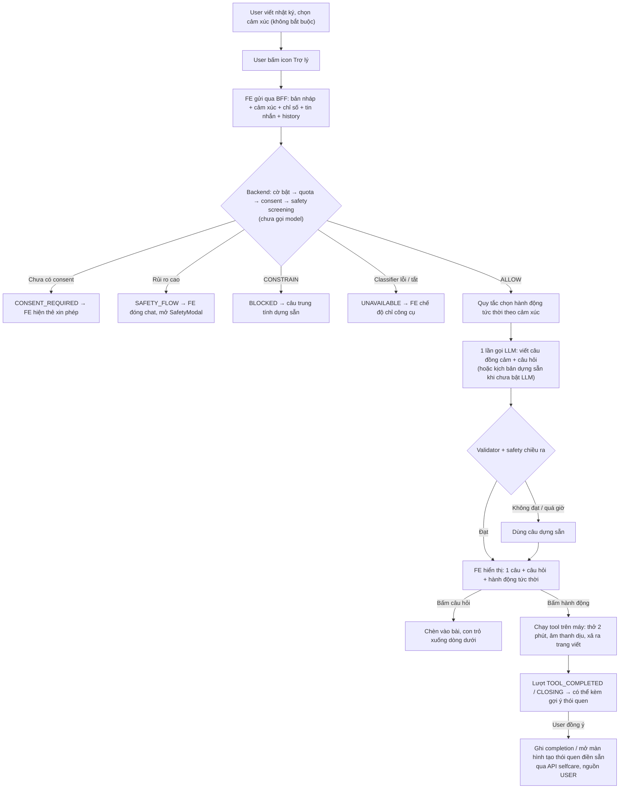

# Kế hoạch Trợ lý đồng hành trong Journal Editor (Companion)

> **Trạng thái tài liệu:** **Giai đoạn 1–5 (code backend + frontend Bước 1–5 của `COMPANION_UI_PLAN.md`) đã triển khai; ở Giai đoạn 4 mới hoàn thành bước 4a (adapter OpenAI + validator + bộ đánh giá dữ liệu giả), các bước 4b–4e (sinh dữ liệu mẫu, fine-tune model nhỏ và duyệt chính sách provider cho dữ liệu thật) chưa triển khai.**
> Hiện trạng (tháng 11/2026):
> - **Giai đoạn 1 & 2–3:** [`WritingSuggestionService`](../src/main/java/com/mylog/journal/application/WritingSuggestionService.java) nhận contract mở rộng (`intent`/`message`/`draft`/`context`/`completedTool`/`history`, tương thích ngược với `{ "text": "..." }`), chạy đúng thứ tự cổng (flag → consent → safety trên toàn cửa sổ hội thoại → `CompanionResponder` → `CompanionHabitSuggestionService`). Quota dùng key `companion-turn` (40 lần/15 phút). Frontend đã xóa `CompanionPopover.tsx`, thay bằng khung chat thật ở `front-end/my-app-web/features/journal/components/companion/` + `calming-tools/`.
> - **Giai đoạn 4a (LLM + Validator + Đánh giá dữ liệu giả):** [`LlmCompanionResponder`](../src/main/java/com/mylog/journal/infrastructure/LlmCompanionResponder.java) gom toàn bộ chuỗi *gọi OpenAI Chat Completions (JSON mode, 1 lần/lượt, timeout 6s) → [`CompanionOutputValidator`](../src/main/java/com/mylog/journal/application/CompanionOutputValidator.java) → safety screening chiều ra + đếm false-positive (`outboundSafetyBlocks`) → tự quay về [`TemplateCompanionResponder`](../src/main/java/com/mylog/journal/infrastructure/TemplateCompanionResponder.java)* vào một chỗ duy nhất; cấu hình qua [`CompanionResponderConfiguration`](../src/main/java/com/mylog/journal/infrastructure/CompanionResponderConfiguration.java) với cờ `MYLOG_COMPANION_GENERATION_ENABLED=false` mặc định. Bộ đánh giá tự động [`CompanionStage4aEvaluationTest`](../src/test/java/com/mylog/journal/CompanionStage4aEvaluationTest.java) kiểm chứng trên dữ liệu giả (synthetic). **Lưu ý:** các bước 4b–4e và phê duyệt provider dữ liệu thật chưa hoàn tất nên `MYLOG_COMPANION_GENERATION_ENABLED` mặc định tắt trên production.
> - **Giai đoạn 5 (Nối công cụ tức thời sang thói quen):** Migration [`V21__companion_habit_linking.sql`](../src/main/resources/db/migration/V21__companion_habit_linking.sql) thêm `habits.tool_code` và bảng `companion_habit_preferences` (thuộc `journal`, bật RLS). Module `selfcare` cung cấp dữ liệu qua [`SelfCareCompanionQuery`](../src/main/java/com/mylog/selfcare/application/SelfCareCompanionQuery.java) (tính `localDate` theo `habit.timezone`, giới hạn xét tương quan tâm trạng trong 90 ngày và chỉ chạy bậc 2 khi bậc 1 trống); module `journal` sở hữu quy tắc gợi ý trong [`CompanionHabitSuggestionService`](../src/main/java/com/mylog/journal/application/CompanionHabitSuggestionService.java), danh mục mẫu [`HabitTemplateCatalog`](../src/main/java/com/mylog/journal/domain/HabitTemplateCatalog.java) và endpoint riêng `POST /api/v1/companion/habit-suggestions/dismiss` ([`CompanionHabitSuggestionController`](../src/main/java/com/mylog/journal/api/CompanionHabitSuggestionController.java)) không tốn quota hội thoại.

Phạm vi: trợ lý giúp người dùng **trong lúc viết nhật ký** trên web. Không bao gồm phân tích sau khi lưu bài (`ai_analyses`, `AiReflectionDrawer`) và mobile; mobile dùng lại contract khi tích hợp sau.

---

## 1. Mục tiêu và nguyên tắc

Người dùng đang viết, khi thấy cần thì bấm icon trợ lý. Trợ lý đọc bài đang viết và cảm xúc đã chọn, rồi trả về **1 câu đồng cảm, vài câu hỏi gợi mở và gợi ý hành động**. Giao diện là một khung chat như Messenger, mở song song với trang viết.

| Nguyên tắc | Nội dung |
|---|---|
| Chỉ khi người dùng yêu cầu | Trợ lý không tự bật, không tự nhắn khi người dùng dừng gõ. Chỉ gọi API khi người dùng bấm icon hoặc gửi tin. |
| Backend quyết định | Backend sở hữu nội dung trả lời, quyết định safety và chọn hành động. Frontend chỉ hiển thị theo `status`. |
| Không phải nhà trị liệu | Không chẩn đoán, không khuyên dùng thuốc, không tự tạo hotline. Câu hỏi mở và cho người dùng lựa chọn, không tra vấn. |
| Không lưu hội thoại | Hội thoại chỉ nằm trong bộ nhớ trình duyệt suốt phiên viết. Backend không lưu, không log `message`/`draft`/`history`. Chỉ nội dung người dùng chủ động chèn vào bài mới đi vào nhật ký. |
| AI chỉ viết câu chữ | Quy tắc trong code quyết định *loại* hành động. LLM chỉ viết câu an ủi và câu hỏi, trong **đúng 1 lần gọi** mỗi lượt. |
| Không tự ghi dữ liệu | Trợ lý không tự tạo thói quen hay đánh dấu hoàn thành. Mọi thao tác ghi đều do người dùng bấm. |

---

## 2. Luồng tổng thể



---

## 3. Hai loại gợi ý hành động

| | **Tức thời** (giải tỏa cảm xúc) | **Thói quen** (ổn định lâu dài) |
|---|---|---|
| Mục đích | Hạ cảm xúc ngay lúc đang viết | Xây nhịp sống giúp cảm xúc ổn định hơn |
| Ví dụ | Thở 2 phút, âm thanh dịu, xả ra trang viết | Thở sâu mỗi tối, ngủ trước 23h, đi bộ 15 phút |
| Nguồn | Danh mục tool cố định trong code (enum) | Thói quen người dùng đã có trong `habits`, hoặc mẫu thói quen do backend quản lý |
| Ghi dữ liệu | Không, chạy trên máy | Có, chỉ khi người dùng đồng ý, qua API selfcare với `source = USER` |
| Thời điểm hiện | Ngay ở câu mở đầu | Sau khi chạy xong tool tức thời hoặc khi khép phiên |
| Vai trò của AI | Viết câu mời | Không dùng AI: câu dựng sẵn, backend chèn tên thói quen |

**Quy tắc cho gợi ý thói quen**
- Không hiện ở câu mở đầu. Không hiện khi tâm trạng `very_bad` hoặc safety ở mức `CONSTRAIN`/`SAFETY_FLOW`.
- Tối đa 1 gợi ý thói quen mỗi ngày. Người dùng bấm "Không, cảm ơn" thì tạm ẩn 7 ngày.
- Thứ tự ưu tiên, do quy tắc ở backend chọn:
  1. Thói quen `ACTIVE` có `tool_code` khớp với tool vừa chạy: đề nghị **ghi nhận hôm nay**.
  2. Thói quen `ACTIVE` mà [`HabitMoodAssociation`](../src/main/java/com/mylog/selfcare/domain/HabitMoodAssociation.java) cho thấy chênh lệch tâm trạng dương (cần ≥ 7 ngày làm và ≥ 7 ngày không làm). Câu chữ phải nói đúng bản chất tương quan, ví dụ "những ngày bạn đi bộ, tâm trạng thường nhẹ hơn", không nói đi bộ là nguyên nhân.
  3. Mẫu thói quen đã duyệt (ánh xạ vào category `SLEEP`/`MINDFULNESS`/`EXERCISE`/`SOCIAL`): mở **màn hình tạo thói quen đã điền sẵn** để người dùng xem và sửa trước khi lưu.
- Không gửi tên hay danh sách thói quen của người dùng cho LLM.

---

## 4. Chiến lược theo cảm xúc (backend sở hữu)

Icon cảm xúc người dùng chọn là tín hiệu chính ở giai đoạn dùng kịch bản. Khi có LLM, nội dung bài viết được ưu tiên hơn icon; **safety tính theo nội dung luôn thắng** mọi tín hiệu khác. Không có icon thì dựa vào giờ trong ngày, giấc ngủ và độ dài bản nháp.

| Cảm xúc | Câu mở | Câu hỏi gợi ý | Hành động tức thời |
|---|---|---|---|
| `happy` | Ghi nhận niềm vui | Giữ lại khoảnh khắc, biết ơn ai/điều gì | Không có — tựa đề gợi ý qua `suggestedTitle` |
| `neutral` | Hỏi han nhẹ | Điều gì đáng nhớ, điều gì còn lấn cấn | Không có — tựa đề gợi ý qua `suggestedTitle` |
| `angry` | Thừa nhận cảm giác bức bối | Chuyện gì chạm vào mình nhất, mình cần điều gì lúc này | Mời chọn: **thở 2 phút** hoặc **xả ra trang viết** |
| `sad` | An ủi, công nhận cảm xúc | 3 mức: nhẹ → sâu hơn → điều từng giúp mình ổn hơn | Âm thanh dịu, thở |
| `very_bad` | An ủi ngắn, ưu tiên làm dịu | Tối đa 1 câu nhẹ | Thở, âm thanh dịu trước; luôn có lựa chọn "Mình chỉ muốn viết tiếp" |
| Safety theo nội dung báo rủi ro cao | Không sinh câu mở | — | Mở `SafetyModal` |

Mỗi cảm xúc có vài biến thể câu chữ để không lặp lại. Mọi lượt đều có lựa chọn thoát, ví dụ "Mình chỉ muốn viết tiếp".

---

## 5. Contract API

`POST /api/v1/journal-writing-suggestions` (giữ đường dẫn, mở rộng body; vẫn nhận request cũ chỉ có `text`). Phía web gọi qua BFF chung `/api/backend/journal-writing-suggestions`, chỉ cần thêm một dòng allowlist trong [`secured-proxy.ts`](../../front-end/my-app-web/features/auth/api/secured-proxy.ts).

```json
// Request
{
  "intent": "OPEN",                       // OPEN | FREE_TEXT | <mã chip> | TOOL_COMPLETED | CLOSING
  "message": "Mình đang bí, không biết viết tiếp sao",   // ≤ 300 ký tự; rỗng khi OPEN
  "draft": {
    "title": "...",                       // ≤ 200 ký tự
    "text": "...",                        // plain text từ TipTap, ≤ 4.000 ký tự, cắt giữ phần CUỐI
    "wordCount": 312,
    "truncated": true
  },
  "context": { "moodCode": "sad", "stressScore": 7.5, "energyScore": 3,
               "sleepMinutes": 300, "localHour": 23 },
  "completedTool": "BREATHING_2MIN",      // chỉ khi intent = TOOL_COMPLETED
  "history": [ { "role": "assistant", "text": "..." }, { "role": "user", "text": "..." } ]  // ≤ 8 lượt, mỗi lượt ≤ 300
}

// Response
{
  "status": "REPLY",                      // REPLY | CONSENT_REQUIRED | SAFETY_FLOW | BLOCKED | UNAVAILABLE
  "reply": "Nghe hôm nay thật nặng lòng.",
  "questions": ["...", "..."],            // 0–3 câu; bấm vào thì chèn vào bài
  "suggestedTitle": null,
  "immediateActions": [ { "code": "BREATHING_2MIN", "label": "Thở chậm 2 phút" } ],
  "habitSuggestion": null,                // chỉ có ở lượt TOOL_COMPLETED / CLOSING
  "chips": [ { "label": "Mình chỉ muốn viết tiếp", "intent": "EXIT" } ],
  "nextState": "LISTENING",               // LISTENING | OFFERED | CLOSING
  "source": "TEMPLATE",                   // TEMPLATE | GENERATED
  "promptVersion": "companion-template-v1"
}
```

**`habitSuggestion`**

```json
{
  "type": "LOG_EXISTING",
  "habitId": "uuid",
  "localDate": "2026-11-08",
  "targetValue": 1,
  "unit": "sessions",
  "text": "Ghi nhận thói quen “Thở sâu mỗi tối” hôm nay nhé?"
}
{
  "type": "CREATE_FROM_TEMPLATE",
  "templateCode": "EVENING_BREATHING",
  "category": "MINDFULNESS",
  "presetTitle": "Thở sâu 2 phút mỗi tối",
  "presetTargetValue": 2,
  "presetUnit": "minutes",
  "presetToolCode": "BREATHING_2MIN",
  "text": "Bạn có muốn thử thở sâu 2 phút mỗi tối?"
}
```
- Với `LOG_EXISTING`, `localDate` do backend tính sẵn theo `habit.timezone` để frontend gọi thẳng `completeHabit(habitId, localDate, targetValue)`, tránh lệch ngày theo đồng hồ trình duyệt.
- Khi người dùng bấm *"Không, cảm ơn"*, frontend gọi endpoint riêng `POST /api/v1/companion/habit-suggestions/dismiss` (không đi qua `POST /api/v1/journal-writing-suggestions` để không tốn quota `companion-turn` và không chạy lại cổng consent/safety).

**Danh mục tool tức thời (enum)**

| Mã | Ý nghĩa |
|---|---|
| `BREATHING_2MIN` | Thở chậm 2 phút |
| `AMBIENT` | Âm thanh dịu |
| `VENT_PROMPT` | Xả ra trang viết |
| `TITLE` | Gợi ý tựa đề (enum vẫn giữ; `TemplateCompanionResponder` hiện không phát mã này — happy/neutral trả tựa đề qua `suggestedTitle` thay vì một hành động riêng) |

Danh mục chỉ mở rộng khi tool mới đã có widget và được duyệt. Quy tắc trong code chọn hành động từ enum này, LLM không sinh mã hành động.

**Giới hạn**
- Quota tách thành key `companion-turn`: 40 lần/15 phút/user (thay cho 20 lần dùng chung).
- Khoảng 12 lượt người dùng trở lên thì trợ lý gợi ý khép phiên nhưng không ép.
- Payload vượt giới hạn trả `400`.

---

## 6. Lộ trình triển khai

### Giai đoạn 1: Backend với kịch bản dựng sẵn (chưa LLM) — ✅ Đã triển khai
Đã làm đúng theo mục này: contract mở rộng và tương thích ngược, `CompanionResponder`/`TemplateCompanionResponder`, thứ tự cổng trong `WritingSuggestionService`, quota `companion-turn`, 4 test đơn vị (REPLY/SAFETY_FLOW không gọi responder hai lần ngoài ý muốn, BLOCKED/UNAVAILABLE không gọi responder, cửa sổ safety gồm bản nháp + lượt user trước + tin nhắn mới, không rò nội dung synthetic). Chưa làm: test tích hợp controller cho payload quá khổ trả `400` (cần Docker/PostgreSQL để chạy `JournalCheckinIntegrationTest`, chưa xác minh được trong phiên không có Docker); "mã hành động lạ bị loại" không áp dụng ở giai đoạn này vì `TemplateCompanionResponder` chỉ phát sinh enum `CompanionActionCode` có sẵn, không có input hành động từ bên ngoài để lọc — việc lọc output thật sự cần khi có `LlmCompanionResponder` ở giai đoạn 4.

- Mở rộng `WritingSuggestionRequest`/`Response` và command/result tương ứng. Request/response DTO đặt ở `journal/api/request|response`, kết quả ở `journal/application/result`.
- Tạo port `CompanionResponder` và `TemplateCompanionResponder`. Chuyển câu chào và kịch bản từ frontend sang, triển khai bảng ở mục 4, thêm nhánh theo bản nháp (chưa viết, viết dở, viết dài).
- Sửa `WritingSuggestionService`: chạy lần lượt các cổng (cờ → quota `companion-turn` → consent `AI_PROCESSING` → screen **bản nháp và cửa sổ tin nhắn của user**, lấy mức rủi ro cao nhất) rồi mới gọi responder.
- Không đưa `draft`/`message`/`history` vào log hay exception; đối chiếu với `SensitiveDataRedactor`.
- Safety khi lưu bài trong `JournalService` vẫn giữ nguyên; safety của trợ lý không thay thế bước này.
- Test:
  - Mỗi status đều có test.
  - Câu khủng hoảng chỉ nằm trong bản nháp → `SAFETY_FLOW`.
  - Câu khủng hoảng nằm ở lượt chat trước → `SAFETY_FLOW`.
  - Payload quá lớn → `400`.
  - Thiếu consent thì không gọi screening.
  - Mã hành động lạ bị loại.
  - Log không chứa nội dung synthetic.

### Giai đoạn 2: Frontend khung chat nối với backend
| File | Vai trò |
|---|---|
| `features/journal/types/companion.types.ts` | Type cho request/response |
| `features/journal/api/companion.ts` | `postCompanionTurn()` qua `apiJson` |
| `features/journal/hooks/useCompanionConversation.ts` | State machine, lấy bản nháp bằng `editorRef.getText()`, `AbortController`, bỏ response cũ, đếm tin chưa đọc |
| `features/journal/components/CompanionPanel.tsx` | Khung chat neo phải (≥ 1360px) hoặc bottom sheet; gõ bài được khi khung đang mở |
| `features/journal/components/CompanionPopover.tsx` | Chỉ giữ phần trình bày (bong bóng chat, chip); bỏ logic hội thoại |
| `features/auth/api/secured-proxy.ts` | Thêm allowlist `POST journal-writing-suggestions` |

- Hành vi theo status:
  - `CONSENT_REQUIRED`: thẻ xin phép ghi rõ trợ lý **đọc tin nhắn và bài đang viết**. Đồng ý thì gọi `/api/me/consents/AI_PROCESSING` rồi gửi lại tin nhắn đang chờ.
  - `SAFETY_FLOW`: đóng chat, xóa hội thoại, mở `SafetyModal`.
  - `BLOCKED`: hiển thị câu trung tính, khóa ô nhập tự do.
  - `UNAVAILABLE`/429/503/mất mạng: chế độ "chỉ công cụ" có nhãn rõ ràng, khóa ô nhập tự do.
- Phải xóa ở frontend: `CRISIS_PATTERNS`, `buildContextualReply`, `getOpeningGreeting`, `hasConsent = true`.
- Hiển thị hai nhịp: khi mở khung chat, hiện ngay câu dựng sẵn theo cảm xúc và các nút hành động; câu hỏi từ backend hiện sau, kèm hiệu ứng "đang gõ".
- Không ghi hội thoại vào `localStorage`. Điểm cảm xúc 1–5 khi khép phiên chỉ giữ trong state, không gửi đi.
- Test: Playwright với route giả cho cả 5 status; gõ bài khi khung chat đang mở; thu nhỏ rồi mở lại vẫn còn hội thoại; tin nhắn mới hủy request cũ. Chạy lint và typecheck.

### Giai đoạn 3: Màn hình tool tức thời
- Widget thở 2 phút (đếm ngược, dừng được), âm thanh dịu (Web Audio offline), xả ra trang viết (chèn 1–2 câu gợi xả vào bài).
- Mỗi tool chạy được dạng mini trong khung chat và mở được toàn màn hình từ menu riêng.
- Tool do đội dev làm và duyệt; người dùng không tự tạo tool.
- Âm thanh/nhạc thật phải là file có bản quyền phù hợp, tự host; không nhúng link ngoài.

### Giai đoạn 4: LLM đọc hiểu bài viết (có cổng duyệt) — provider: OpenAI (ChatGPT)
- Adapter `LlmCompanionResponder`: dùng lại cách gọi **OpenAI Chat Completions (`Authorization: Bearer`)** của [`OpenAiJournalAnalyzer`](../src/main/java/com/mylog/analysis/infrastructure/OpenAiJournalAnalyzer.java) — cùng kiểu adapter, không phải `GeminiReflectiveQuestionGenerator` (đó là provider Gemini cho feature RAG câu hỏi suy ngẫm, không liên quan). Dùng chung cấu hình `mylog.ai.*` đã có (xem mục 8) thay vì `mylog.rag.*`. Output JSON có schema (`reply` ≤ 2 câu, `questions` ≤ 3). Timeout khoảng 4 giây.
- **Một điểm dự phòng duy nhất**: `WritingSuggestionService` vẫn chỉ giữ đúng 1 port `CompanionResponder`. Toàn bộ chuỗi (**gọi OpenAI → `CompanionOutputValidator` → safety screening chiều ra → quay về `TemplateCompanionResponder` khi lỗi/quá giờ/không đạt**) nằm gọn trong `LlmCompanionResponder` (nhận `TemplateCompanionResponder` làm fallback nội bộ). Không chia logic fallback ra hai nơi.
- Không RAG: input chỉ gồm bản nháp, lịch sử hội thoại và cảm xúc — không truy xuất từ `knowledge_items`/embedding. Nếu sau này muốn thêm RAG cho companion, đây là một quyết định thiết kế riêng, chưa nằm trong kế hoạch này.
- Prompt: vai trò bạn đồng hành, bám nội dung bài viết, mỗi câu hỏi mở và cho người dùng lựa chọn. Bản nháp được bọc làm dữ liệu, kèm chỉ dẫn bỏ qua mọi "lệnh" nằm trong bài (chống prompt injection). Có `promptVersion`; không lưu prompt hay response.
- `CompanionOutputValidator`:
  - Kiểm tra schema và độ dài (`reply` ≤ 2 câu, `questions` ≤ 3). Không cần lọc mã hành động vì LLM không sinh hành động (quy tắc trong code quyết định `immediateActions`, `chips`, `nextState`).
  - Không có từ ngữ chẩn đoán, không có hotline hay URL.
  - Đoạn trích bài viết (nếu có) phải có thật trong bản nháp.
  - Sau validator thì chạy safety screening chiều ra. **Lưu ý về chặn nhầm (false positive):** classifier hiện tại được huấn luyện để nhận diện rủi ro trong lời người dùng nên có thể đánh dấu nhầm câu an ủi của trợ lý (ví dụ *"nghe bạn buồn thật"*). Ở bước **4a**, phải đo tỷ lệ chặn nhầm của cổng chiều ra trên bộ đánh giá synthetic trước khi coi đây là cổng chặn cứng.
- Cờ riêng `mylog.companion.generation.enabled` cùng `mylog.ai.provider-data-approved`, mặc định `false`. Ghi quyết định data handling theo ADR-0004 (lưu ý ChatGPT/OpenAI có chính sách retention và data-use riêng, khác Gemini — cần đánh giá lại, không suy ra từ phê duyệt đã có cho feature RAG).
- Khi bật LLM, thẻ consent và header phải nói rõ nội dung bài viết được gửi tới OpenAI.
- Bộ đánh giá synthetic tiếng Việt, gồm các ca: vui/buồn/giận/kiệt sức/bí ý; cảm xúc chọn ngược với nội dung; giận nhưng muốn xả; câu khủng hoảng nằm giữa đoạn; prompt injection. Chỉ số: mức bám nội dung, tỷ lệ output bị chặn (bao gồm tỷ lệ chặn nhầm ở safety chiều ra), tỷ lệ bỏ sót safety, p95 độ trễ (ước lượng ban đầu khoảng 2–4 giây cho model tầm trung, cần đo thật).

#### Chiến lược model: model mạnh để hoàn thiện, fine-tune model rẻ để chạy lâu dài

| Bước | Làm gì | Dữ liệu được dùng |
|---|---|---|
| 4a. Hoàn thiện tính năng | Dùng model mạnh để viết prompt, nối adapter, chạy bộ đánh giá, chốt chất lượng. Chỉ chạy nội bộ, chưa bật cho người dùng thật. | Chỉ dữ liệu giả |
| 4b. Sinh bộ hội thoại mẫu | Cho model mạnh chạy trên bản nháp và hội thoại giả (đủ các ca trong bảng cảm xúc mục 4) để sinh dữ liệu huấn luyện. Người soát lại ngẫu nhiên khoảng 10–20%, loại bỏ câu chẩn đoán, khuyên như chuyên gia, bỏ sót tín hiệu nguy hiểm. | Chỉ dữ liệu giả |
| 4c. Fine-tune model rẻ | Fine-tune model rẻ hoặc miễn phí bằng bộ mẫu ở 4b. Mục tiêu: giọng văn đúng kiểu mylog, câu hỏi gợi mở đúng cách, JSON ổn định. | Chỉ dữ liệu giả |
| 4d. Kiểm tra lại từ đầu | Chạy lại **toàn bộ** bộ đánh giá cho model đã fine-tune, so với kết quả của model mạnh ở 4a trên cùng bộ câu hỏi. Không coi là tương đương nếu chưa chạy. | Chỉ dữ liệu giả |
| 4e. Deploy cho người dùng thật | Chuyển sang gói/provider có cam kết **không dùng dữ liệu gửi lên để huấn luyện** (hoặc tự host). Duyệt chính sách dữ liệu theo ADR-0004, rồi mới tính chi phí và bật cờ. | Dữ liệu thật, chỉ sau khi duyệt |

**Quy tắc bắt buộc:**
- Gói miễn phí thường được phép dùng dữ liệu gửi lên để huấn luyện model của họ. Chỉ được gửi dữ liệu giả lên gói đó. Nội dung nhật ký thật **không bao giờ** đi qua gói miễn phí loại này.
- Không dùng nhật ký thật để fine-tune, kể cả sau khi deploy.
- Fine-tuning giúp AI trả lời đúng giọng và đều hơn, **không thay** các hàng rào ở backend. Vẫn giữ nguyên: danh mục hành động cố định, `CompanionOutputValidator`, safety screening trước và sau khi gọi AI, `TemplateCompanionResponder` làm phương án dự phòng khi AI lỗi hoặc quá giờ.
- Mỗi lần đổi model (mạnh → fine-tune, hoặc đổi provider) đều phải qua lại bước 4d.

### Giai đoạn 5: Nối tool với thói quen
- **Migration mới (`V21`)**:
  - Thêm cột `habits.tool_code VARCHAR(32)` (có thể null). Đánh đổi có chủ đích: gắn `CHECK (tool_code IS NULL OR tool_code IN ('BREATHING_2MIN', 'AMBIENT', 'VENT_PROMPT'))` ngay ở DB để chặn dữ liệu sai tại tầng lưu trữ; đổi lại khi thêm mã tool mới trong `journal` cần thêm migration mở rộng `CHECK`.
  - Tạo bảng `companion_habit_preferences(user_id UUID PRIMARY KEY REFERENCES users(id) ON DELETE CASCADE, last_suggested_date DATE, dismissed_until TIMESTAMPTZ, updated_at TIMESTAMPTZ NOT NULL)` thuộc sở hữu của module **`journal`** (không thuộc `selfcare`), kèm thu hồi grant (`PUBLIC`, `anon`, `authenticated`) và bật RLS theo ADR-0008.
- **Ranh giới trách nhiệm giữa `selfcare` và `journal`**:
  - **`selfcare` chỉ cung cấp dữ liệu qua query facade**:
    1. Danh sách thói quen `ACTIVE` (thuộc Goal `ACTIVE`) có `tool_code = X`, kèm trạng thái hôm nay đã hoàn thành chưa và `localDate` "hôm nay" tính theo `habit.timezone`.
    2. Thói quen `ACTIVE` chưa hoàn thành hôm nay có tương quan tâm trạng dương theo [`HabitMoodAssociation`](../src/main/java/com/mylog/selfcare/domain/HabitMoodAssociation.java). **Tối ưu hiệu năng**: chỉ gọi tính tương quan (Bậc 2) khi Bậc 1 (khớp `tool_code`) không có kết quả, và giới hạn cửa sổ dữ liệu xét (90 ngày gần nhất).
  - **`journal` sở hữu quy tắc gợi ý của trợ lý**:
    - Chặn khi `moodCode == "very_bad"`, giới hạn tối đa 1 gợi ý/ngày (`last_suggested_date`), ẩn 7 ngày (`dismissed_until`), thứ tự ưu tiên Bậc 1 (`tool_code`) → Bậc 2 (`HabitMoodAssociation`) → Bậc 3 (danh mục mẫu `habit_templates` trong code).
    - Module `journal` không import entity hay repository của `selfcare`.
- **Từ chối gợi ý ("Không, cảm ơn")**:
  - Dùng một endpoint nhỏ riêng `POST /api/v1/companion/habit-suggestions/dismiss` trong module `journal` (kèm allowlist trong `secured-proxy.ts`), không đi qua `POST /api/v1/journal-writing-suggestions` để không tốn quota `companion-turn` (40 lượt/15 phút) và không chạy lại cổng consent/safety screening.
- **Ghi nhận và tạo thói quen**:
  - Cho người dùng chọn "gắn với công cụ" (`tool_code`) khi tạo hoặc sửa thói quen.
  - Việc ghi completion do frontend gọi thẳng API `selfcare` đang có với `localDate` mà backend đã tính sẵn theo `habit.timezone` (nguồn `USER`).

---

## 7. Điều kiện hoàn thành

| Giai đoạn | Xong khi |
|---|---|
| 1 | `./mvnw.cmd test` qua; gọi endpoint bằng dữ liệu synthetic thì đủ 5 status đều trả đúng |
| 2 | Chạy cục bộ với cờ bật thì đủ 5 status có giao diện đúng; frontend không còn kịch bản hay safety tự viết |
| 3 | Mỗi tool chạy được trong chat và toàn màn hình; dừng hoặc đóng giữa chừng không lỗi |
| 4 | Model đã fine-tune đạt ngưỡng bộ đánh giá (bước 4d), đã chuyển sang gói không dùng dữ liệu để huấn luyện và chính sách dữ liệu được duyệt (bước 4e); chỉ khi đó bật cờ ở môi trường thật |
| 5 | Ghi nhận thói quen chỉ xảy ra khi người dùng bấm; không có completion với nguồn khác `USER`; giới hạn tần suất có test |

Mỗi giai đoạn cập nhật kèm [`AI_ANALYSIS_GUIDE.md`](AI_ANALYSIS_GUIDE.md) và mục gợi ý khi viết trong [`BACKEND_ARCHITECTURE.md`](BACKEND_ARCHITECTURE.md). Hai tài liệu này hiện vẫn ghi frontend journal dùng mock/`localStorage`, trong khi editor đã lưu bài lên server.

## 8. Cấu hình

```properties
# backend/.env (không commit)
MYLOG_WRITING_SUGGESTIONS_ENABLED=true          # bật trợ lý (kịch bản, giai đoạn 1)
MYLOG_COMPANION_GENERATION_ENABLED=false        # giai đoạn 4, chỉ bật sau khi duyệt

# Giai đoạn 4 dùng chung block mylog.ai.* đã có (cùng adapter kiểu OpenAiJournalAnalyzer),
# không dùng mylog.rag.* (đó là Gemini, cho feature RAG câu hỏi suy ngẫm, không liên quan).
MYLOG_AI_PROVIDER=openai
MYLOG_AI_ENDPOINT=https://api.openai.com/v1/chat/completions
MYLOG_AI_MODEL=gpt-4o-mini                      # chốt model cụ thể khi đánh giá xong
MYLOG_AI_API_KEY=<API_KEY_CHATGPT>              # không commit, không log
MYLOG_AI_PROVIDER_DATA_APPROVED=true            # chỉ bật sau khi duyệt chính sách dữ liệu OpenAI
MYLOG_AI_OUTPUT_SAFETY_APPROVED=true
```

`MYLOG_AI_*` hiện cũng được [`OpenAiJournalAnalyzer`](../src/main/java/com/mylog/analysis/infrastructure/OpenAiJournalAnalyzer.java) dùng cho feature phân tích bài viết đã lưu — companion dùng chung provider/model/key này theo mặc định. Nếu cần tách biệt (ví dụ account billing riêng, hoặc model khác cho companion), chuyển sang một block `mylog.companion.ai.*` riêng khi triển khai thật, không tự ý giả định dùng chung nếu chưa xác nhận.

`MYLOG_COMPANION_GENERATION_ENABLED` là cờ dự kiến, chưa có trong `application.yml`. Tên cờ chốt khi làm giai đoạn 4.
