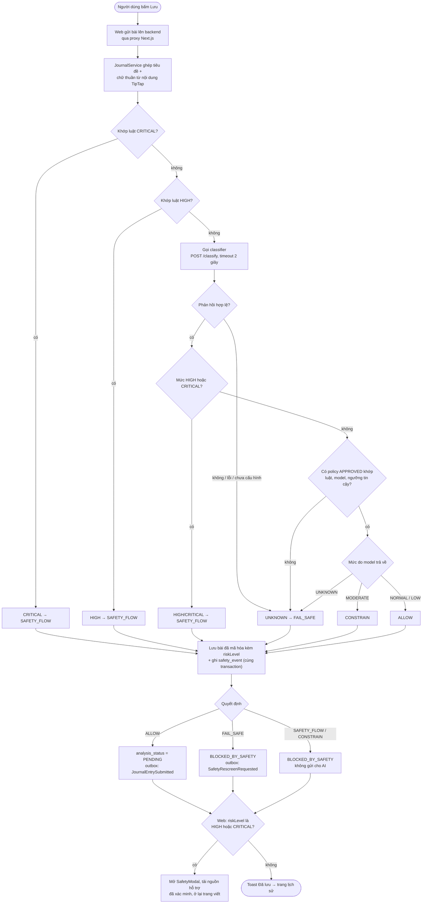
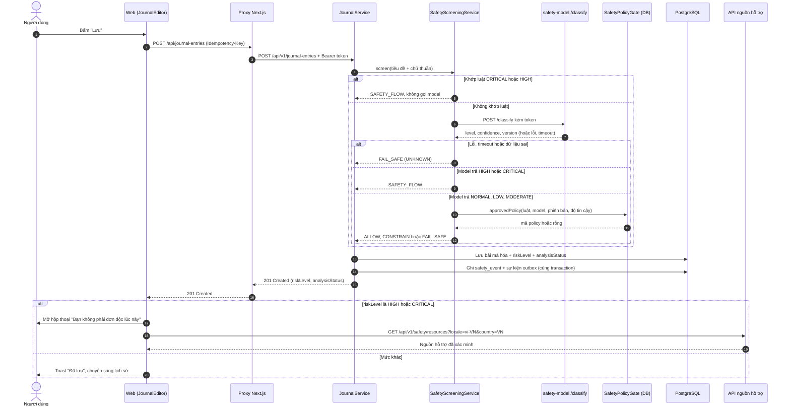

# Sàng lọc an toàn nội dung nhật ký (safety screening)

Tài liệu này mô tả **luồng đang chạy trong code** tại thời điểm 2026-11-14: cách backend nhận diện ngôn từ nguy hiểm khi người dùng lưu nhật ký, quyết định có cho AI xử lý hay không, và cách web cảnh báo người dùng.

Các tài liệu liên quan:

- [ADR-0003](adr/0003-layered-safety-screening.md): quyết định kiến trúc safety nhiều lớp và fail-safe.
- [BACKEND_ARCHITECTURE.md §11](BACKEND_ARCHITECTURE.md#11-safety-pipeline): yêu cầu tổng quát của safety pipeline.
- [AI_ANALYSIS_GUIDE.md §4](AI_ANALYSIS_GUIDE.md#4-safety-là-cổng-vào-và-cổng-ra): safety trong vòng đời phân tích AI.
- [SAFETY_CLASSIFIER_MODEL_PLAN.md](SAFETY_CLASSIFIER_MODEL_PLAN.md): kế hoạch train và duyệt classifier.
- [SAFETY_M2_EVALUATION.md](SAFETY_M2_EVALUATION.md): kết quả regression corpus synthetic của bộ luật hiện tại.

> mylog là ứng dụng nhật ký và tự suy ngẫm, không chẩn đoán hay điều trị. Sàng lọc an toàn không phải dịch vụ khẩn cấp và không tự liên hệ bên thứ ba.

## 1. Mục tiêu và phạm vi

Sàng lọc an toàn trả lời hai câu hỏi cho mỗi lần lưu hoặc sửa một trang nhật ký:

1. Trang này có dấu hiệu nguy cơ (tự hại, tự sát) để hiển thị hỗ trợ an toàn cho người dùng không?
2. Trang này có được đưa vào hàng đợi phân tích AI thông thường không?

Nguyên tắc:

- **Bài luôn được lưu.** Sàng lọc chỉ quyết định bước AI phía sau và lời cảnh báo, không chặn việc ghi nhật ký.
- **Fail-safe.** Mọi chỗ không chắc chắn (classifier chưa cấu hình, timeout, phản hồi sai, chưa có policy được duyệt) đều cho kết quả `FAIL_SAFE`: bài được lưu nhưng không gửi cho AI.
- **Báo nhầm ít hại hơn bỏ sót.** Kết quả rủi ro cao được tin ngay; kết quả rủi ro thấp phải có policy đã duyệt mới được dùng.
- **Không lưu đoạn văn bản kích hoạt.** Nhật ký an toàn (`safety_events`) chỉ lưu mức rủi ro, quyết định và phiên bản luật/model/policy.

Cùng bộ sàng lọc này cũng được dùng cho gợi ý viết và cho chữ do AI sinh ra (xem [§9](#9-sàng-lọc-gợi-ý-viết-và-đầu-ra-ai)).

## 2. Thành phần

| Thành phần | Vai trò | File |
|---|---|---|
| `SafetyScreeningUseCase` | Port duy nhất các module khác gọi: `SafetyDecision screen(String plainText)` | [`safety/application/SafetyScreeningUseCase.java`](../src/main/java/com/mylog/safety/application/SafetyScreeningUseCase.java) |
| `SafetyScreeningService` | Luật từ khóa → classifier → policy gate → quyết định | [`safety/application/SafetyScreeningService.java`](../src/main/java/com/mylog/safety/application/SafetyScreeningService.java) |
| `RiskClassifier` | Port gọi model phân loại rủi ro | [`safety/application/RiskClassifier.java`](../src/main/java/com/mylog/safety/application/RiskClassifier.java) |
| `HttpRiskClassifier` | Gọi dịch vụ `safety-model` qua HTTP, kiểm tra phản hồi | [`safety/infrastructure/HttpRiskClassifier.java`](../src/main/java/com/mylog/safety/infrastructure/HttpRiskClassifier.java) |
| `UnavailableRiskClassifier` | Dùng khi chưa cấu hình URL; luôn trả rỗng → `FAIL_SAFE` | [`safety/infrastructure/UnavailableRiskClassifier.java`](../src/main/java/com/mylog/safety/infrastructure/UnavailableRiskClassifier.java) |
| `DevSafetyAllowConfiguration` | Classifier giả cho máy local (luôn `NORMAL`) | [`safety/infrastructure/DevSafetyAllowConfiguration.java`](../src/main/java/com/mylog/safety/infrastructure/DevSafetyAllowConfiguration.java) |
| `SafetyPolicyGate` / `JpaSafetyPolicyGate` | Tìm policy `APPROVED` khớp luật, model và ngưỡng tin cậy | [`safety/infrastructure/persistence/JpaSafetyPolicyGate.java`](../src/main/java/com/mylog/safety/infrastructure/persistence/JpaSafetyPolicyGate.java) |
| `SafetyEventRecorder` / `JpaSafetyEventRecorder` | Ghi một dòng `safety_events` cho mỗi lần sàng lọc bài | [`safety/infrastructure/persistence/JpaSafetyEventRecorder.java`](../src/main/java/com/mylog/safety/infrastructure/persistence/JpaSafetyEventRecorder.java) |
| `SafetyAnalysisPermission` / `JpaSafetyAnalysisPermission` | Worker AI hỏi lại quyền trước khi phân tích | [`safety/infrastructure/persistence/JpaSafetyAnalysisPermission.java`](../src/main/java/com/mylog/safety/infrastructure/persistence/JpaSafetyAnalysisPermission.java) |
| `SafetyResourceController` | `GET /api/v1/safety/resources`: nguồn hỗ trợ đã duyệt | [`safety/api/SafetyResourceController.java`](../src/main/java/com/mylog/safety/api/SafetyResourceController.java) |
| `JournalService` | Gọi sàng lọc khi tạo, sửa, sàng lọc lại bài | [`journal/application/JournalService.java`](../src/main/java/com/mylog/journal/application/JournalService.java) |
| `safety-model` | Dịch vụ Python `POST /classify` và pipeline train | [`../../safety-model/`](../../safety-model/README.md) |

## 3. Mức rủi ro và quyết định

`RiskLevel`: `UNKNOWN`, `NORMAL`, `LOW`, `MODERATE`, `HIGH`, `CRITICAL`.

`SafetyDecision` gồm `riskLevel`, `decision`, `ruleVersion`, `classifier`, `classifierVersion`, `policyVersion`, `confidence`, `resourceSetVersion`. Chỉ `decision = ALLOW` mới cho phép phân tích AI thông thường (`permitsOrdinaryAnalysis()`).

| Decision | Khi nào | `analysis_status` của bài | Sự kiện outbox | Người dùng thấy trên web |
|---|---|---|---|---|
| `SAFETY_FLOW` | Khớp luật CRITICAL/HIGH, hoặc classifier trả `HIGH`/`CRITICAL` | `BLOCKED_BY_SAFETY` | Không có | Hộp thoại hỗ trợ an toàn, ở lại trang viết |
| `CONSTRAIN` | Classifier trả `MODERATE` và có policy duyệt | `BLOCKED_BY_SAFETY` | Không có | Toast "Đã lưu"; panel phân tích ghi không có gợi ý tự động |
| `FAIL_SAFE` | Classifier lỗi/chưa cấu hình/trả sai, không có policy, hoặc `UNKNOWN` | `BLOCKED_BY_SAFETY` | `SafetyRescreenRequested` | Toast "Đã lưu"; chưa có phân tích |
| `ALLOW` | Classifier trả `NORMAL`/`LOW` và có policy duyệt | `PENDING` (khi sửa bài: `ANALYSIS_OUTDATED`) | `JournalEntrySubmitted` | Toast "Đã lưu", chuyển sang trang lịch sử |

Với `FAIL_SAFE`, `riskLevel` là `UNKNOWN`. Với `SAFETY_FLOW` từ luật, `classifier`, `classifierVersion` và `confidence` để trống vì model không được gọi.

## 4. Thuật toán `screen()`

`SafetyScreeningService.screen(text)` chạy theo thứ tự sau. Hàm không bao giờ ném lỗi ra ngoài: mọi `RuntimeException` bên trong đều thành `FAIL_SAFE`, nên lỗi classifier không làm hỏng việc lưu bài.

### 4.1 Lớp 1: luật từ khóa

Luật là hai biểu thức chính quy **viết cứng trong code** ([`SafetyScreeningService.java:14-21`](../src/main/java/com/mylog/safety/application/SafetyScreeningService.java#L14-L21)), không lưu trong database hay file cấu hình:

```java
private static final String RULE_VERSION = "m2-curated-draft-v1";
private static final String POLICY_VERSION = "m2-fail-safe-v1";

private static final Pattern CRITICAL = Pattern.compile(
    "\\b(kill myself now|end my life now|suicide tonight)\\b|(?:tự tử|tự sát).{0,40}(?:ngay|tối nay|hôm nay)",
    Pattern.CASE_INSENSITIVE | Pattern.UNICODE_CASE);

private static final Pattern HIGH = Pattern.compile(
    "\\b(kill myself|end my life|want to die|self harm)\\b|(?:muốn chết|không muốn sống|tự tử|tự sát|tự hại)",
    Pattern.CASE_INSENSITIVE | Pattern.UNICODE_CASE);
```

- Văn bản được đổi sang chữ thường (`Locale.ROOT`) rồi so khớp bằng `find()`, tức là khớp ở bất kỳ vị trí nào.
- **CRITICAL** được kiểm tra trước: ý định kèm thời điểm cụ thể, ví dụ "tự tử" hoặc "tự sát" theo sau trong vòng 40 ký tự là "ngay", "tối nay", "hôm nay".
- **HIGH**: "muốn chết", "không muốn sống", "tự tử", "tự sát", "tự hại" và bốn cụm tiếng Anh.
- Khớp là trả ngay `SAFETY_FLOW` với `ruleVersion = m2-curated-draft-v1`, **không gọi classifier**. Nhờ vậy tín hiệu khủng hoảng rõ ràng không phụ thuộc vào việc model có chạy hay không.
- Luật không hiểu ngữ cảnh: câu phủ định ("I don't want to die") hay trích dẫn vẫn bị xếp HIGH. Đây là false positive đã biết, xem [SAFETY_M2_EVALUATION.md](SAFETY_M2_EVALUATION.md).

Database chỉ lưu **tên phiên bản** luật: cột `safety_events.rule_version` và khóa `ruleVersion` trong `safety_policy_versions.config`. Quy trình đổi luật nằm ở [§13](#13-thay-đổi-luật-từ-khóa-hoặc-model).

### 4.2 Lớp 2: classifier

Chỉ chạy khi luật không khớp. Bean `RiskClassifier` được chọn trong [`RiskClassifierConfiguration`](../src/main/java/com/mylog/safety/infrastructure/RiskClassifierConfiguration.java):

- `mylog.safety.classifier.url` trống → `UnavailableRiskClassifier` (luôn rỗng → `FAIL_SAFE`).
- Có URL → `HttpRiskClassifier`.
- `mylog.safety.dev-allow.enabled=true` → classifier giả của `DevSafetyAllowConfiguration` được ưu tiên (xem [§12](#12-cấu-hình)).

**Contract với `safety-model`** ([`serve.py`](../../safety-model/serve.py)):

```http
POST /classify
Authorization: Bearer <MYLOG_SAFETY_CLASSIFIER_TOKEN>
Content-Type: application/json

{ "text": "<tiêu đề + chữ thuần>" }
```

```json
{ "level": "NORMAL", "confidence": 0.93, "version": "<phiên bản model>" }
```

`HttpRiskClassifier` chỉ chấp nhận cấu hình an toàn và phản hồi hợp lệ:

- URL phải là `https`, hoặc `http` tới `localhost`/`127.0.0.1`; không có user-info, query, fragment. Token bắt buộc; timeout 100–10000 ms (mặc định 2000 ms). Sai cấu hình thì backend không khởi động.
- Phản hồi bị loại (trả rỗng → `FAIL_SAFE`) nếu: mã khác 200, thân dài quá 8 KB, thiếu `level`/`confidence`/`version`, `confidence` không phải số hoặc ngoài 0–1, `version` không khớp `[A-Za-z0-9._:-]{1,80}`, hoặc `level` không phải giá trị `RiskLevel`.
- Không log văn bản gửi đi hay phản hồi.
- Provider luôn được gán là `MYLOG_INTERNAL`; không có biến cấu hình cho provider.

Phía `safety-model`:

- Model là pipeline scikit-learn: `TfidfVectorizer` theo ký tự (n-gram 2–5) + `LogisticRegression(class_weight="balanced")`, nhãn `NORMAL`, `LOW`, `MODERATE`, `HIGH`, `CRITICAL` ([`train.py`](../../safety-model/train.py)).
- Dịch vụ kiểm tra checksum SHA-256 của artifact và chỉ khởi động khi `manifest.json` có `approved: true`. Pipeline train ghi `approved: false`, nên model phải được người duyệt bật tay.
- Nếu xác suất cao nhất dưới `MYLOG_SAFETY_MODEL_MIN_CONFIDENCE` (mặc định 0.8), dịch vụ trả `UNKNOWN`.

Sau khi nhận kết quả hợp lệ:

- `HIGH`/`CRITICAL` → `SAFETY_FLOW` ngay, không cần policy.
- Các mức còn lại đi tiếp sang policy gate.

### 4.3 Lớp 3: policy gate

Kết quả rủi ro thấp chỉ được dùng khi `SafetyPolicyGate.approvedPolicy(ruleVersion, provider, classifierVersion, confidence, now)` trả về một mã policy. `JpaSafetyPolicyGate` tìm trong `safety_policy_versions` dòng thỏa **tất cả** điều kiện:

- `status = 'APPROVED'`, có `approved_by` và `approved_at <= now`;
- `effective_from <= now` và (`effective_to` trống hoặc `> now`);
- `config.allowOrdinaryAnalysis = true`;
- `config.ruleVersion`, `config.classifierProvider`, `config.classifierVersion` khớp chính xác kết quả hiện tại;
- `confidence >= config.minConfidence` (0–1).

Ví dụ `config` (minh họa, không phải policy đã duyệt):

```json
{
  "allowOrdinaryAnalysis": true,
  "ruleVersion": "m2-curated-draft-v1",
  "classifierProvider": "MYLOG_INTERNAL",
  "classifierVersion": "<phiên bản model>",
  "minConfidence": 0.85
}
```

Có nhiều policy khớp thì lấy policy có `effective_from` mới nhất. Không có policy → `FAIL_SAFE`. Có policy:

| Mức classifier | Quyết định |
|---|---|
| `NORMAL`, `LOW` | `ALLOW` |
| `MODERATE` | `CONSTRAIN` |
| `UNKNOWN` | `FAIL_SAFE` |

`policyVersion` lưu vào `SafetyDecision` là mã policy tìm được. Với `SAFETY_FLOW` và `FAIL_SAFE`, `policyVersion` là hằng `m2-fail-safe-v1`.

## 5. Sơ đồ hoạt động



## 6. Sơ đồ tuần tự



Giải thích:

- **Bước 1–3:** trình duyệt không gọi thẳng backend. Proxy Next.js giữ token đăng nhập ở server và chuyển yêu cầu kèm `Idempotency-Key`, nên bấm Lưu hai lần chỉ tạo một bài.
- **Bước 4–12:** toàn bộ việc xếp loại nằm trong `SafetyScreeningService`.
- **Bước 13–16:** bài, `safety_event` và sự kiện outbox được commit trong cùng một transaction; không thể có bài đã lưu mà thiếu kết quả sàng lọc.
- **Bước 17–19:** cảnh báo là việc của web. API nguồn hỗ trợ là API công khai, gọi thẳng backend bằng `NEXT_PUBLIC_BACKEND_URL`.

## 7. Tích hợp với journal

`JournalService` gọi `screening.screen(title + "\n" + plainText)` ở ba chỗ. `plainText` được backend tự rút từ JSON TipTap (`TipTapContent.plainText`), không lấy từ client.

| Thao tác | `riskLevel` | `analysis_status` mới | Outbox |
|---|---|---|---|
| `create` (tạo bài) | Theo quyết định | `ALLOW` → `PENDING`, khác → `BLOCKED_BY_SAFETY` | `ALLOW` → `JournalEntrySubmitted`; `FAIL_SAFE` → `SafetyRescreenRequested` |
| `update` (sửa bài, tăng `content_version`) | Theo quyết định mới | `ALLOW` → `ANALYSIS_OUTDATED`, khác → `BLOCKED_BY_SAFETY` | `JournalEntryChanged`, rồi như `create` |
| `rescreen` (worker) | Theo quyết định mới | `ALLOW` → `PENDING`, khác → giữ `BLOCKED_BY_SAFETY` | `ALLOW` → `JournalEntrySubmitted` |

Mỗi lần `create`/`update` ghi một dòng `safety_events`. `rescreen` chỉ ghi khi có kết quả khác `FAIL_SAFE`.

Response `JournalEntryResponse` và `JournalSummaryResponse` trả về `riskLevel` và `analysisStatus`; client dùng hai trường này để hiển thị, không tự quyết định safety.

## 8. Sau khi lưu: các lớp kiểm tra tiếp theo

### 8.1 Sàng lọc lại bài `FAIL_SAFE`

[`JournalSafetyOutboxHandler`](../src/main/java/com/mylog/journal/infrastructure/persistence/JournalSafetyOutboxHandler.java) xử lý `SafetyRescreenRequested` (chỉ khi `MYLOG_JOBS_ENABLED=true`):

1. Tìm chủ bài theo `entryId` + `content_version` (bài đã bị sửa hoặc xóa thì bỏ qua).
2. Gọi `JournalService.rescreen`. Chỉ xử lý khi bài vẫn ở `BLOCKED_BY_SAFETY` và đúng `content_version`.
3. Nếu kết quả vẫn là `FAIL_SAFE`, handler ném `IllegalStateException("POLICY_NOT_READY")` để outbox worker thử lại sau.

### 8.2 Kiểm tra lại ngay trước khi AI chạy

[`AnalysisJobHandler`](../src/main/java/com/mylog/analysis/application/AnalysisJobHandler.java) gọi `SafetyAnalysisPermission.permits(userId, entryId)` **hai lần**: trước khi gọi `JournalAnalyzer` và trước khi lưu kết quả. `JpaSafetyAnalysisPermission` chỉ cho phép khi:

- `safety_event` mới nhất của bài có `decision = ALLOW`, và
- policy của event đó vẫn được `SafetyPolicyGate` chấp nhận tại thời điểm hiện tại với đúng `policy_version`.

Nếu policy bị thu hồi hoặc hết hiệu lực giữa chừng, job dừng với `POLICY_BLOCKED` và bài chuyển sang `BLOCKED_BY_SAFETY`; kết quả đang có không được dùng.

## 9. Sàng lọc gợi ý viết và đầu ra AI

Cùng `SafetyScreeningUseCase` được dùng ở các luồng khác, với cùng luật và policy:

| Nơi dùng | Văn bản được sàng lọc | Xử lý theo quyết định |
|---|---|---|
| [`WritingSuggestionService`](../src/main/java/com/mylog/journal/application/WritingSuggestionService.java) (`POST /api/v1/journal-writing-suggestions`) | Bản nháp + mọi lượt của người dùng trong lịch sử hội thoại + tin nhắn mới | `ALLOW` → trả gợi ý; `SAFETY_FLOW` → trả trạng thái `SAFETY_FLOW`; `CONSTRAIN` → `BLOCKED` kèm câu trả lời cố định; khác → `UNAVAILABLE` |
| [`LlmCompanionResponder`](../src/main/java/com/mylog/journal/infrastructure/LlmCompanionResponder.java) | Câu trả lời, câu hỏi gợi mở, tiêu đề gợi ý do LLM sinh | Khác `ALLOW` → đếm `outboundSafetyBlocks`; khi `MYLOG_COMPANION_OUTBOUND_SAFETY_HARD_BLOCK=true` (mặc định) thì trả câu trả lời mẫu thay cho câu LLM |
| [`NarrativeRewriter`](../src/main/java/com/mylog/insight/application/NarrativeRewriter.java) | Câu insight do AI viết lại | Chỉ nhận câu có `ALLOW`, còn lại giữ câu mẫu |

Ngoài ra có các validator đầu ra với danh sách từ cấm riêng, cũng viết cứng trong code. Chúng **không phải** luật sàng lọc nhật ký:

- [`CompanionOutputValidator`](../src/main/java/com/mylog/journal/application/CompanionOutputValidator.java): câu của bạn đồng hành không được có "tự tử", "tự sát", "đường dây nóng", "trị liệu"… (so khớp có dấu để phân biệt "tự tử" với "từ từ").
- [`InsightNarrativeValidator`](../src/main/java/com/mylog/insight/application/InsightNarrativeValidator.java): câu insight không được dùng từ chẩn đoán như "trầm cảm", "rối loạn", "thuốc", "điều trị".
- [`AnalysisOutputValidator`](../src/main/java/com/mylog/analysis/application/AnalysisOutputValidator.java): reflection của phân tích AI không được chứa "tự tử"/"suicide" và một số từ khác. Đây là baseline, xem [AI_ANALYSIS_GUIDE.md §4](AI_ANALYSIS_GUIDE.md#4-safety-là-cổng-vào-và-cổng-ra).

## 10. Cảnh báo người dùng trên web

| File | Việc làm |
|---|---|
| [`useJournalEditor.ts`](../../front-end/my-app-web/features/journal/hooks/useJournalEditor.ts) | Sau khi lưu, nếu `saved.riskLevel` là `HIGH` hoặc `CRITICAL` thì mở `SafetyModal` và **không** chuyển trang; các mức khác hiện toast "Đã lưu" rồi chuyển sang `/history-calendar`. |
| [`SafetyModal.tsx`](../../front-end/my-app-web/features/journal/components/SafetyModal.tsx) | Hộp thoại "Bạn không phải đơn độc lúc này": nhắc AI không thay thế hỗ trợ trực tiếp, gợi ý liên hệ người tin cậy hoặc dịch vụ khẩn cấp, liệt kê nguồn hỗ trợ đã xác minh (nếu có). Nút "Tiếp tục viết sổ" và "Rời khỏi và về Dashboard". |
| [`safety-resources.ts`](../../front-end/my-app-web/features/journal/api/safety-resources.ts) | Gọi `GET /api/v1/safety/resources?locale=vi-VN&country=VN`, chỉ giữ mục có `sourceUrl` bắt đầu bằng `https://`. |
| [`EntryAnalysisPanel.tsx`](../../front-end/my-app-web/features/journal/components/EntryAnalysisPanel.tsx) | Bài `BLOCKED_BY_SAFETY` hiện "Trang này không có gợi ý tự động…"; nếu rủi ro cao thì có nút mở hỗ trợ an toàn. |

API nguồn hỗ trợ (`SafetyResourceService` / `JpaSafetyResourceCatalog`) kiểm tra `locale` dạng `vi` hoặc `vi-VN`, `country` hai chữ in hoa, và chỉ trả dòng `safety_resources` có `status = 'APPROVED'`, `verified_at` khác null và `source_url` bắt đầu bằng `https://`. Model và LLM không được tự tạo số hotline.

## 11. Dữ liệu được lưu

| Bảng ([V7](../src/main/resources/db/migration/V7__safety.sql)) | Nội dung |
|---|---|
| `safety_events` | Mỗi lần sàng lọc bài: `user_id`, `subject_ref` (HMAC của user, dùng `lookupHash`), `journal_entry_id`, `risk_level`, `decision`, `rule_version`, `classifier`, `classifier_version`, `policy_version`, `confidence`, `resource_set_version`, `created_at`. **Không lưu văn bản.** |
| `safety_policy_versions` | Policy được duyệt: `version`, `status` (`DRAFT`/`APPROVED`/`RETIRED`), `config` JSONB, `approved_by`, `approved_at`, `effective_from`, `effective_to`. |
| `safety_resources` | Nguồn hỗ trợ theo `locale`/`country_code`: tên, loại, liên hệ, mô tả, `source_url`, `verified_at`, `status`, `version`. |

Bảng `journal_entries` lưu thêm `risk_level` và `analysis_status` của bài. Nội dung bài được mã hóa ứng dụng (ADR-0002); sàng lọc đọc văn bản trong bộ nhớ lúc lưu, không ghi ra log.

## 12. Cấu hình

| Biến môi trường | Thuộc tính | Mặc định | Ý nghĩa |
|---|---|---|---|
| `MYLOG_SAFETY_CLASSIFIER_URL` | `mylog.safety.classifier.url` | trống | URL `POST /classify`. Trống → không có classifier → mọi bài không khớp luật là `FAIL_SAFE`. |
| `MYLOG_SAFETY_CLASSIFIER_TOKEN` | `mylog.safety.classifier.token` | trống | Bearer token gửi tới `safety-model`; bắt buộc khi có URL. |
| `MYLOG_SAFETY_CLASSIFIER_TIMEOUT_MS` | `mylog.safety.classifier.timeout-ms` | `2000` | 100–10000 ms. |
| `MYLOG_SAFETY_DEV_ALLOW` | `mylog.safety.dev-allow.enabled` | `false` | Chỉ cho máy local, xem dưới. |
| `MYLOG_JOBS_ENABLED` | `mylog.jobs.enabled` | `false` | Bật outbox worker (sàng lọc lại) và job phân tích AI. |
| `MYLOG_COMPANION_OUTBOUND_SAFETY_HARD_BLOCK` | `mylog.companion.generation.outbound-safety-hard-block` | `true` | Thay câu LLM của bạn đồng hành bằng câu mẫu khi đầu ra không được `ALLOW`. |

Phía `safety-model`: `MYLOG_SAFETY_MODEL_DIR` (thư mục chứa `model.joblib` và `manifest.json`), `MYLOG_SAFETY_CLASSIFIER_TOKEN` (cùng token với backend), `MYLOG_SAFETY_MODEL_MIN_CONFIDENCE` (mặc định 0.8).

**`MYLOG_SAFETY_DEV_ALLOW`** thay classifier bằng một classifier giả luôn trả `NORMAL` (confidence 1, provider `dev-allow`, phiên bản `dev`) và tự duyệt policy `dev-allow-local` cho đúng provider đó. Luật từ khóa vẫn chạy trước như thật. Backend từ chối khởi động nếu bật biến này ngoài profile `local`, hoặc bật cùng `MYLOG_JOBS_ENABLED=true` (để bài thật không bị đưa sang AI nhờ policy giả). Chỉ dùng với dữ liệu synthetic.

## 13. Thay đổi luật từ khóa hoặc model

Luật nằm trong code nên mọi thay đổi cần deploy lại backend:

1. Sửa `CRITICAL`/`HIGH` trong `SafetyScreeningService`.
2. Đổi `RULE_VERSION` sang tên mới để `safety_events` phân biệt được kết quả cũ và mới.
3. Cập nhật và chạy `SafetyScreeningCorpusTest`; cập nhật [SAFETY_M2_EVALUATION.md](SAFETY_M2_EVALUATION.md) nếu kết quả thay đổi.
4. Tạo và duyệt policy mới trong `safety_policy_versions` có `config.ruleVersion` bằng tên mới. Policy cũ tham chiếu tên cũ sẽ không còn khớp, nên **trong lúc chưa có policy mới, mọi bài không khớp luật sẽ là `FAIL_SAFE`** và AI tạm dừng.

Đổi model cũng tương tự: phiên bản trong `manifest.json` phải khớp `config.classifierVersion` của một policy đã duyệt. ADR-0003 yêu cầu mọi thay đổi luật, ngưỡng, classifier hoặc nội dung phản hồi đều phải có phiên bản và chạy regression corpus.

## 14. Kiểm thử

| Test | Phạm vi |
|---|---|
| [`SafetyScreeningCorpusTest`](../src/test/java/com/mylog/safety/SafetyScreeningCorpusTest.java) | Corpus synthetic tiếng Việt/Anh: định tuyến của luật, fail-safe khi không có classifier |
| [`HttpRiskClassifierTest`](../src/test/java/com/mylog/safety/infrastructure/HttpRiskClassifierTest.java) | Kiểm tra cấu hình và từ chối phản hồi sai |
| [`DevSafetyAllowConfigurationTest`](../src/test/java/com/mylog/safety/infrastructure/DevSafetyAllowConfigurationTest.java) | Dev-allow chỉ chạy ở `local`, không đi cùng jobs |
| [`JournalCheckinIntegrationTest`](../src/test/java/com/mylog/journal/JournalCheckinIntegrationTest.java) | Lưu bài với PostgreSQL thật, trạng thái phân tích theo quyết định |
| [`WritingSuggestionServiceTest`](../src/test/java/com/mylog/journal/WritingSuggestionServiceTest.java), [`CompanionStage4aEvaluationTest`](../src/test/java/com/mylog/journal/CompanionStage4aEvaluationTest.java) | Sàng lọc gợi ý viết và đầu ra bạn đồng hành |

Test chỉ dùng dữ liệu synthetic, không dùng nhật ký thật.

## 15. Giới hạn hiện tại và việc còn mở

- Bộ luật `m2-curated-draft-v1` là bản nháp ngắn, không hiểu phủ định, trích dẫn hay mỉa mai.
- Model trong `safety-model` chưa được duyệt; chưa có policy production nào trong `safety_policy_versions`. Khi không bật dev-allow, mọi bài không khớp luật đều là `FAIL_SAFE` và không được phân tích AI.
- Chưa có dòng `safety_resources` nào được duyệt, nên hộp thoại chưa hiện số liên hệ cụ thể.
- `MODERATE` (`CONSTRAIN`) và `FAIL_SAFE` chỉ chặn AI, không hiện cảnh báo cho người dùng. Luồng phản hồi có ràng buộc cho `MODERATE` chưa được thiết kế.
- `SafetyModal` có prop `detectedKeywords` nhưng web luôn truyền mảng rỗng; người dùng không biết cụm từ nào kích hoạt cảnh báo.
- `resource_set_version` trong `safety_events` hiện luôn để trống.
- Luật không chỉnh được lúc chạy; mọi thay đổi cần deploy (xem [§13](#13-thay-đổi-luật-từ-khóa-hoặc-model)).
