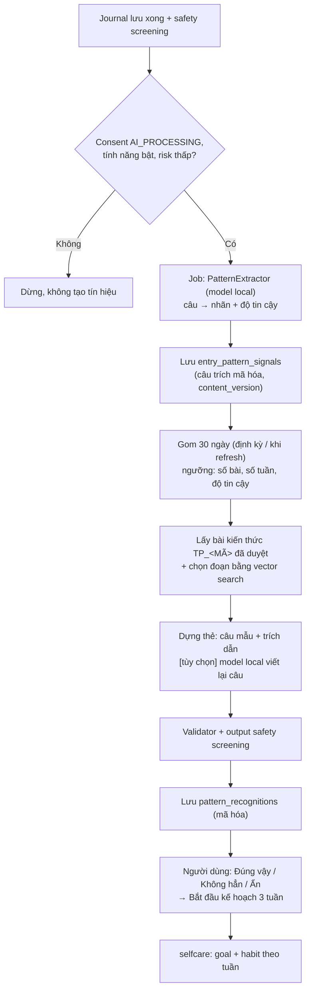

# Kế hoạch: Nhận diện kiểu suy nghĩ và thói quen (Pattern Recognition)

> **Trạng thái tài liệu:** thiết kế ban đầu ngày 2026-11-19; cập nhật đối chiếu ngày 2026-11-22: đã có schema [V22](../src/main/resources/db/migration/V22__thinking_pattern_recognition.sql), luồng trích tín hiệu trong `analysis/application/PatternExtractionService`, persistence trong `JpaPatternSignalStore`/`JpaThinkingPatternStore`, và [ThinkingPatternController](../src/main/java/com/mylog/insight/api/ThinkingPatternController.java) với các API đọc/làm mới/phản hồi/bắt đầu kế hoạch. Database đang cấu hình đã áp dụng V22. Các mục bên dưới vẫn chứa thiết kế và công việc dự kiến; sự tồn tại của code/schema không xác nhận model, nội dung, giao diện hoặc provider đã được duyệt và kiểm chứng để phát hành. Kiểm thử integration PostgreSQL chưa được chạy lại trong lần đối chiếu này vì Docker daemon không hoạt động.
>
> **Phụ thuộc:** kho kiến thức RAG (`knowledge`, đã có), pattern insight `pattern-30d-v2` (đã có), tính năng thói quen `selfcare` (đã có), model local chạy qua Ollama (chưa có), quy trình duyệt nội dung có người chuyên môn (chưa có).

---

## 1. Mục tiêu

Giúp người dùng **nhận ra những kiểu suy nghĩ và thói quen lặp lại của chính mình**, đọc từ nhật ký họ đã viết, rồi gợi ý cách thay đổi **từng bước nhỏ** trong vài tuần.

Cảm giác người dùng cần có khi đọc: *"À, hóa ra trước giờ mình hay nghĩ theo kiểu này. Nó có tên, nhiều người cũng vậy, và có cách để bớt dần."*

Ba yếu tố tạo ra cảm giác đó:

1. **Dẫn chứng bằng chính lời người dùng viết.** Trích 1–2 câu thật từ nhật ký của họ, kèm ngày.
2. **Gọi tên và bình thường hóa.** Kiểu suy nghĩ có tên trong tâm lý học, và rất nhiều người cũng gặp.
3. **Cho người dùng xác nhận.** AI hỏi "Điều này có đúng với bạn không?" chứ không khẳng định. Người dùng là người quyết định.

Sau đó là một **kế hoạch 3 tuần** với các bước rất nhỏ, gắn vào tính năng thói quen đã có. Hết 3 tuần, app so sánh tần suất kiểu suy nghĩ đó trước và sau.

### Ví dụ thẻ người dùng thấy

> **Có thể bạn hay "đoán trước điều tệ nhất"**
>
> Trong 30 ngày qua, có 6 bài bạn viết theo kiểu này, ví dụ:
> - *"chắc sếp sẽ đánh giá mình kém sau buổi họp"* (12/11)
> - *"lỡ thi trượt thì coi như hết"* (20/11)
>
> Tâm lý học gọi đây là **thảm họa hóa**: tâm trí nhảy thẳng tới kết cục xấu nhất, dù nó hiếm khi xảy ra. Rất nhiều người có thói quen này, nhất là khi đang chịu áp lực. *(Nguồn: …)*
>
> Điều này có đúng với bạn không? **[Đúng vậy]** **[Không hẳn]**
>
> **Thử từng bước trong 3 tuần:**
> - Tuần 1: mỗi khi nhận ra mình đang nghĩ kiểu này, chỉ cần ghi lại.
> - Tuần 2: hỏi mình "khả năng thật sự là bao nhiêu phần trăm?"
> - Tuần 3: viết ra kết quả *có thể xảy ra nhất*, không chỉ kết quả tệ nhất.
>
> **[Bắt đầu kế hoạch]** **[Để sau]**

---

## 2. Ranh giới

| Được làm | Không được làm |
|---|---|
| Gọi tên **kiểu suy nghĩ, thói quen, vòng lặp hành vi** | Gọi tên **bệnh** hoặc rối loạn ("bạn bị trầm cảm", "rối loạn lo âu") |
| Diễn đạt dạng khả năng kèm câu hỏi ("Có thể bạn…, có đúng không?") | Khẳng định ("Bạn là người cầu toàn") hoặc gán loại tính cách cố định |
| Gợi ý hành động nhỏ có nguồn từ kho kiến thức đã duyệt | Khuyên dùng thuốc, liệu pháp cụ thể, hoặc tự tạo hotline |
| Gợi ý nói chuyện với chuyên gia khi tín hiệu kéo dài hoặc nặng | Thay thế chuyên gia, hoặc dùng thẻ để "sàng lọc" bệnh |
| Chỉ chạy khi người dùng đã đồng ý và bật tính năng | Tự chạy trên nhật ký khi chưa có consent, hoặc gửi nhật ký ra cloud |

**Không làm phần sàng lọc bằng bảng hỏi chuẩn (PHQ-9, GAD-7) trong tính năng này.** Đó là một tính năng y tế riêng, cần quyết định sản phẩm và pháp lý riêng. Nếu sau này làm, người dùng phải tự chọn làm bảng hỏi; AI không được suy ra điểm từ nhật ký.

Mọi bài có `risk_level` HIGH/CRITICAL và mọi cửa sổ có bài như vậy **không tạo thẻ**. Người dùng đi luồng safety hiện có ([ADR-0003](adr/0003-layered-safety-screening.md), [SAFETY_SCREENING_FLOW.md](SAFETY_SCREENING_FLOW.md)).

---

## 3. Danh mục kiểu suy nghĩ và thói quen (bộ nhãn v1)

Danh mục này vừa là **danh sách bài kiến thức** cần soạn, vừa là **bộ nhãn** để gán nhãn dữ liệu và fine-tune model. Mã nhãn cố định, dùng làm `topic_code` của bài kiến thức với tiền tố `TP_` (ví dụ `TP_CATASTROPHIZING`; `topic_code` hiện là `VARCHAR(48)`, mẫu `[A-Z0-9_]{1,48}`).

Nhóm A dựa trên các "bẫy suy nghĩ" (cognitive distortions) của liệu pháp nhận thức – hành vi (CBT). Nhóm B là các vòng lặp cảm xúc – hành vi thường được mô tả trong tài liệu giáo dục tâm lý. Nhóm C là tín hiệu mất cân bằng, chỉ dùng để gợi ý nghỉ ngơi hoặc tìm hỗ trợ.

### Nhóm A: Bẫy suy nghĩ

| Mã | Tên hiển thị | Nhận ra qua câu kiểu | Bước đầu tiên gợi ý |
|---|---|---|---|
| `CATASTROPHIZING` | Đoán trước điều tệ nhất | "lỡ… thì coi như hết", "chắc chắn sẽ hỏng" | Ghi lại mỗi lần nhận ra |
| `ALL_OR_NOTHING` | Nghĩ kiểu "tất cả hoặc không có gì" | "không hoàn hảo thì vô nghĩa", "lại thất bại hoàn toàn" | Tìm một mức "tạm được" ở giữa |
| `OVERGENERALIZATION` | Vơ đũa cả nắm | "lúc nào cũng vậy", "chẳng bao giờ được" | Tìm một lần ngoại lệ |
| `MIND_READING` | Đoán ý người khác | "chắc họ nghĩ mình…", "ai cũng thấy mình phiền" | Tách điều mình biết và điều mình đoán |
| `SHOULD_STATEMENTS` | Áp lực "phải" | "mình phải…", "đáng lẽ không được…" | Đổi "phải" thành "mình muốn/mình chọn" |
| `SELF_LABELING` | Dán nhãn bản thân | "mình đúng là đồ vô dụng", "mình ngu thật" | Mô tả hành động, không mô tả con người |
| `PERSONALIZATION` | Nhận hết lỗi về mình | "tại mình mà…", "mọi chuyện hỏng là do mình" | Liệt kê các yếu tố khác góp phần |
| `DISCOUNTING_POSITIVE` | Gạt bỏ điều tốt | "được khen chỉ là may", "chuyện nhỏ thôi" | Ghi một điều tốt mà không kèm "nhưng" |
| `EMOTIONAL_REASONING` | Lấy cảm xúc làm bằng chứng | "mình thấy tệ nên chắc mình tệ thật" | Hỏi "bằng chứng ngoài cảm giác là gì?" |

### Nhóm B: Vòng lặp và thói quen

| Mã | Tên hiển thị | Nhận ra qua câu kiểu | Bước đầu tiên gợi ý |
|---|---|---|---|
| `RUMINATION` | Nghĩ đi nghĩ lại chuyện đã qua | "cứ nghĩ mãi về…", "không dứt ra được" | Đặt "giờ để nghĩ" 10 phút, ngoài giờ thì ghi lại để sau |
| `WORRY_LOOP` | Lo lắng vòng tròn về tương lai | "lo không ngủ được", "nghĩ đủ kịch bản" | Tách điều mình kiểm soát được và không được |
| `AVOIDANCE` | Né tránh | "lại để đó", "không dám mở tin nhắn" | Làm 2 phút đầu tiên của việc đang né |
| `PROCRASTINATION_GUILT` | Trì hoãn rồi tự trách | "lại lướt điện thoại cả tối, ghét bản thân" | Chia việc thành bước nhỏ nhất, tự nhắc mình bằng giọng tử tế |
| `PERFECTIONISM` | Cầu toàn | "chưa đủ tốt", "làm lại lần thứ ba" | Đặt tiêu chuẩn "đủ tốt" trước khi làm |
| `PEOPLE_PLEASING` | Khó từ chối, đặt người khác lên trước | "không dám từ chối", "sợ họ buồn" | Tập một lời từ chối nhỏ, an toàn |
| `HARSH_SELF_CRITICISM` | Giọng nói bên trong khắt khe | "mình thật thảm hại", "không xứng đáng" | Hỏi "mình sẽ nói gì với một người bạn?" |
| `SOCIAL_WITHDRAWAL` | Thu mình | "không muốn gặp ai", "ở nhà cả tuần" | Một liên lạc nhỏ mỗi tuần (một tin nhắn) |

### Nhóm C: Tín hiệu mất cân bằng (chỉ gợi ý nghỉ ngơi/hỗ trợ)

| Mã | Tên hiển thị | Ghi chú |
|---|---|---|
| `SUSTAINED_OVERLOAD` | Quá tải kéo dài | Kết hợp tín hiệu văn bản với điểm căng thẳng/giấc ngủ có cấu trúc. Thẻ luôn có câu gợi ý nói chuyện với người tin tưởng hoặc chuyên gia. |
| `NEGLECTED_REST` | Ít dành thời gian nghỉ | Ví dụ "không có thời gian cho bản thân", "làm liên tục". Gợi ý một khoảng nghỉ nhỏ có lịch. |

**Không đưa vào danh mục:** tên bệnh, rối loạn, chẩn đoán, triệu chứng lâm sàng; nội dung tự hại (thuộc safety); nhãn tính cách (MBTI, hướng nội/hướng ngoại, cung hoàng đạo, thần số học).

Danh mục chỉ thêm/bớt qua một phiên bản mới (`taxonomy_version`), vì nó đồng thời là bộ nhãn của model.

---

## 4. Kho kiến thức

### 4.1 Khuôn bài cho mỗi mã

Mỗi mã có **một bài** trong `knowledge_items` (`topic_code = TP_<MÃ>`, `locale = vi`), dùng đúng các tiêu đề dưới đây để chunking cắt theo mục và để backend lấy đúng phần cần hiển thị:

```markdown
# <Tên hiển thị>

## Đây là gì
2–3 câu, ngôn ngữ đời thường, không thuật ngữ y khoa.

## Nhận ra qua những câu như
3–5 câu ví dụ tổng hợp (không lấy từ nhật ký thật).

## Vì sao nhiều người gặp
Bình thường hóa: tâm trí làm vậy để tự bảo vệ, hay gặp khi áp lực.

## Thử từng bước (3 tuần)
- Tuần 1: nhận ra và ghi lại.
- Tuần 2: một câu hỏi để kiểm tra lại suy nghĩ.
- Tuần 3: một hành động thay thế nhỏ.

## Khi nào nên tìm thêm hỗ trợ
Dấu hiệu cho thấy nên nói chuyện với người tin tưởng hoặc chuyên gia. Không nêu hotline (nguồn hỗ trợ khẩn cấp lấy từ `/api/v1/safety/resources` đã duyệt).

## Nguồn
Tên tổ chức, tên tài liệu, URL https.
```

### 4.2 Nguồn và duyệt nội dung

- **Nguồn ưu tiên:** WHO, NHS, các hướng dẫn tự giúp đỡ dựa trên CBT của cơ sở y tế công, APA, tài liệu của Bộ Y tế. Kiểm tra quyền sử dụng trước khi đưa vào; viết lại bằng lời của mylog thay vì sao chép.
- **Người duyệt:** ít nhất một người có chuyên môn tâm lý duyệt từng bài. Dùng quy trình `DRAFT → IN_REVIEW → APPROVED` đã có trong module `knowledge` ([KNOWLEDGE_M6_API.md](KNOWLEDGE_M6_API.md)).
- **Embedding:** bài kiến thức là nội dung công khai nên có thể tiếp tục embed bằng provider hiện có (Gemini, qua [`KnowledgeEmbeddingWorker`](../src/main/java/com/mylog/knowledge/infrastructure/embedding/KnowledgeEmbeddingWorker.java)).

### 4.3 Vai trò của vector DB trong tính năng này

Mỗi mã khớp đúng một bài, nên **lấy bài theo `topic_code` là đủ** cho phần chính của thẻ. Vector search dùng cho:

1. **Chọn đoạn phù hợp nhất trong bài** với câu người dùng đã viết (ví dụ chọn ví dụ "công việc" hay "học tập" để giải thích).
2. **Gợi ý kiểu liên quan** ("người hay đoán trước điều tệ nhất cũng thường lo lắng vòng tròn").
3. **Cho model local ngữ cảnh** khi sinh câu chữ: chỉ đưa các đoạn đã duyệt, không để model tự bịa kiến thức.

Nếu sau này embed cả **nhật ký** (ví dụ để tìm bài cũ tương tự), phải dùng model embedding **chạy local**, bảng riêng, owner-scoped, và xóa theo bài/tài khoản. Không làm trong phạm vi v1.

---

## 5. Kiến trúc và luồng xử lý



### 5.1 Phân chia module (theo quy ước hiện có)

| Bước | Module sở hữu | Ghi chú |
|---|---|---|
| Trích tín hiệu từng bài | `analysis` | Cùng loại việc với phân tích bài hiện có: chạy trong worker, kiểm tra consent lúc thực thi, chỉ active khi `content_version` còn khớp. Port mới `PatternExtractor` trong `analysis/application`, adapter `OllamaPatternExtractor` và `FakePatternExtractor` (local/test) trong `analysis/infrastructure`. |
| Gom 30 ngày, dựng thẻ, phản hồi | `insight` | Giống `PatternDetectors`/`ContrastDetectors`: ngưỡng xác định trong domain, LLM chỉ được viết lại câu. Đọc tín hiệu qua query port, không import entity của `analysis`. |
| Bài kiến thức | `knowledge` | Dùng `ApprovedKnowledgeRetriever` hiện có; thêm truy vấn theo `topic_code` chính xác. |
| Kế hoạch 3 tuần | `selfcare` | Tạo goal + habit qua use case hiện có; không tạo bảng kế hoạch riêng ở v1. |

### 5.2 Ngưỡng để hiện một thẻ (domain, xác định)

Một mã chỉ thành thẻ khi **tất cả** đều đúng trong 30 ngày gần nhất:

- Có ở **≥ 3 bài khác nhau**, trải trên **≥ 2 tuần lịch** (tránh một tuần tồi tệ bị coi là thói quen).
- Độ tin cậy trung bình của các tín hiệu dùng làm dẫn chứng **≥ ngưỡng đã hiệu chỉnh** cho mã đó (mục 7.4).
- Cửa sổ không có bài HIGH/CRITICAL (`DailyAggregateSource.hasElevatedRisk` đã có).
- Người dùng chưa trả lời "Không hẳn" cho mã này trong 60 ngày qua, và chưa ẩn mã này.

Giới hạn hiển thị: **tối đa 1 thẻ mới mỗi tuần**, tối đa 3 thẻ đang mở. Nhận diện nhiều kiểu cùng lúc dễ làm người dùng thấy mình "có vấn đề" thay vì thấy được giúp.

### 5.3 Trích dẫn

- Chỉ trích **câu người dùng đã viết**, tối đa 2 câu mỗi thẻ, mỗi câu tối đa 160 ký tự (cắt bằng "…").
- Câu trích được mã hóa khi lưu (giống narrative của insight), chỉ hiện cho chính chủ, không gửi tới provider cloud nào.
- Bài bị xóa hoặc sửa (đổi `content_version`) thì tín hiệu của bài đó không còn dùng; thẻ đang hiện bỏ câu trích đó ở lần làm mới tiếp theo.

### 5.4 Câu chữ của thẻ

- **Mặc định:** câu mẫu đã duyệt, ghép từ tên hiển thị + số bài + phần "Đây là gì" và "Vì sao nhiều người gặp" của bài kiến thức.
- **Tùy chọn:** model local viết lại cho tự nhiên hơn, theo cơ chế giống [`NarrativeRewriter`](../src/main/java/com/mylog/insight/application/NarrativeRewriter.java): không thêm số liệu, giữ câu hỏi cuối, qua validator và output safety; lỗi thì quay về câu mẫu.
- **Validator** mở rộng từ [`InsightNarrativeValidator`](../src/main/java/com/mylog/insight/application/InsightNarrativeValidator.java): thêm danh sách tên bệnh/rối loạn bị cấm, bắt buộc có câu hỏi xác nhận, cấm khẳng định tính cách ("bạn là người…").

---

## 6. Dữ liệu (đề xuất, migration V22 trở lên)

Migration mới nhất trong repo là V21. Mọi bảng mới phải thu hồi grant của `anon`/`authenticated` và bật RLS không có policy ([ADR-0008](adr/0008-backend-only-database-api.md)), có `user_id` + index, và được xử lý trong xóa tài khoản, "Bắt đầu hành trình mới" (`data:reset`) và export.

### `entry_pattern_signals` (module `analysis`)

| Cột | Kiểu | Ghi chú |
|---|---|---|
| `id` | UUID | UUIDv7 |
| `user_id` | UUID | FK users, `ON DELETE CASCADE` |
| `journal_entry_id` | UUID | FK journal_entries, `ON DELETE CASCADE` |
| `content_version` | INTEGER | Chỉ dùng khi còn khớp bài hiện tại |
| `pattern_code` | VARCHAR(48) | Mã trong danh mục |
| `taxonomy_version` | VARCHAR(16) | Ví dụ `tp-v1` |
| `confidence` | NUMERIC(5,4) | 0–1, đã hiệu chỉnh |
| `encrypted_quote`, `quote_iv`, `quote_wrapped_key`, `quote_key_version` | BYTEA/VARCHAR | Câu trích, mã hóa theo ADR-0002 |
| `extractor_model`, `extractor_version` | VARCHAR | Để truy vết và đánh giá lại |
| `created_at` | TIMESTAMPTZ | |

Unique: `(journal_entry_id, content_version, pattern_code, taxonomy_version)` để job chạy lại không nhân đôi.

### `pattern_recognitions` (module `insight`)

| Cột | Kiểu | Ghi chú |
|---|---|---|
| `id` | UUID | |
| `user_id` | UUID | |
| `pattern_code`, `taxonomy_version` | VARCHAR | |
| `period_start`, `period_end`, `timezone` | DATE/VARCHAR | Cửa sổ 30 ngày |
| `status` | VARCHAR(24) | `ACTIVE`, `SUPERSEDED`, `HIDDEN` |
| `user_feedback` | VARCHAR(24) | `NULL`, `CONFIRMED`, `NOT_REALLY` |
| `feedback_at` | TIMESTAMPTZ | |
| `entry_count`, `week_count` | INTEGER | Số liệu để hiển thị và kiểm tra ngưỡng |
| `knowledge_version_id` | UUID | Bài kiến thức đã dùng (truy vết nguồn) |
| `encrypted_narrative` (+ iv/key) | BYTEA | Câu hiển thị |
| `generated_by` | VARCHAR(24) | `TEMPLATE`, `AI_ASSISTED` |
| `plan_goal_id` | UUID NULL | Goal trong `selfcare` nếu người dùng bắt đầu kế hoạch |
| `created_at` | TIMESTAMPTZ | |

Bằng chứng (danh sách tín hiệu đã dùng) lưu ở bảng nối `pattern_recognition_evidence(recognition_id, signal_id)` để xóa bài kéo theo bỏ bằng chứng.

---

## 7. Model nhận diện (phần bạn sẽ fine-tune)

### 7.1 Bài toán

Cho một bài nhật ký, tách câu, và với mỗi câu trả về **0 hoặc nhiều mã** trong danh mục kèm độ tin cậy. Đây là bài toán **phân loại đa nhãn theo câu**, không phải sinh văn bản.

Đầu ra (contract giữa adapter và backend):

```json
{
  "taxonomyVersion": "tp-v1",
  "sentences": [
    { "index": 3, "labels": [ { "code": "CATASTROPHIZING", "confidence": 0.91 } ] },
    { "index": 7, "labels": [ { "code": "SELF_LABELING", "confidence": 0.78 },
                              { "code": "HARSH_SELF_CRITICISM", "confidence": 0.66 } ] }
  ]
}
```

Backend tự cắt câu và tự lấy văn bản câu từ bài đã giải mã theo `index`; model **không trả lại văn bản** (tránh model sửa hay bịa trích dẫn).

### 7.2 Chọn model

| Lựa chọn | Ưu | Nhược | Khuyến nghị |
|---|---|---|---|
| **Encoder nhỏ** (PhoBERT, XLM-R base/large) fine-tune phân loại đa nhãn theo câu | Nhanh, rẻ, chạy CPU được, ổn định, độ tin cậy dễ hiệu chỉnh | Không sinh câu chữ | **Dùng cho nhận diện (v1)** |
| **LLM nhỏ** (Qwen 2.5/3 7B–14B) + LoRA, chạy qua Ollama | Hiểu ngữ cảnh dài tốt hơn, có thể viết lại câu chữ | Chậm, cần GPU, khó hiệu chỉnh độ tin cậy, có thể trả mã ngoài danh mục | Dùng cho **viết lại câu chữ** của thẻ; thử làm bộ nhận diện thứ hai nếu encoder không đạt |

Hai việc nhận diện và viết câu chữ nên tách riêng: bộ nhận diện cần chính xác và ổn định, bộ viết câu chữ cần tự nhiên. Nếu chỉ dùng một LLM cho cả hai, lỗi của một bên khó tách ra để sửa.

Phục vụ model: endpoint private (giống `safety-model/serve.py` của [ADR-0009](adr/0009-hybrid-ai-inference.md)), timeout ngắn, lỗi thì bỏ qua bài đó (không tạo tín hiệu), không chặn việc lưu nhật ký.

### 7.3 Dữ liệu train

- **Không dùng nhật ký thật** trong v1. Consent `MODEL_TRAINING` đã có trong hệ thống nhưng chưa có quy trình trích dữ liệu, ẩn danh hóa và phê duyệt; muốn dùng phải có kế hoạch và phê duyệt riêng.
- **Nguồn dữ liệu v1:**
  1. Câu tổng hợp do người viết theo hướng dẫn gán nhãn (đa dạng bối cảnh: học, làm, gia đình, tình cảm, sức khỏe; đa dạng giọng: teen, sinh viên, người đi làm; có cả không dấu và teencode).
  2. Câu do LLM sinh rồi **người duyệt và sửa nhãn**. Không dùng nhãn do LLM tự gán mà chưa duyệt.
  3. **Câu âm tính khó (hard negatives):** câu nghe giống nhưng không phải, ví dụ lo lắng có căn cứ ("mai thi mà mình chưa ôn chương 3") khác thảm họa hóa; tự nhận lỗi có cơ sở khác nhận hết lỗi về mình. Thiếu nhóm này, model sẽ báo nhầm rất nhiều.
  4. Câu trung tính (kể chuyện, mô tả ngày) chiếm đa số, đúng như nhật ký thật.
- **Quy mô gợi ý:** ≥ 300 câu dương tính mỗi mã, ≥ 3.000 câu âm tính/trung tính, tách tập train/validation/test theo **người viết** (không để câu của cùng một người nằm ở cả train và test).
- **Hướng dẫn gán nhãn:** mỗi mã có định nghĩa, 5 ví dụ đúng, 5 ví dụ dễ nhầm và cách phân biệt với mã gần nó (ví dụ `RUMINATION` vs `WORRY_LOOP`: quá khứ vs tương lai). Hai người gán nhãn độc lập trên 10% dữ liệu, đo độ đồng thuận (Cohen's kappa ≥ 0.6 mới dùng mã đó).

### 7.4 Đánh giá và ngưỡng phát hành

Ưu tiên **precision** (độ chính xác khi báo có) hơn recall (độ bao phủ): bỏ sót một kiểu thì người dùng không mất gì, báo sai thì người dùng mất niềm tin.

| Chỉ số | Ngưỡng để một mã được bật |
|---|---|
| Precision theo câu, trên tập test cố định | ≥ 0.85 |
| Recall theo câu | ≥ 0.50 |
| Tỉ lệ báo nhầm trên bài trung tính | ≤ 2% số bài |
| Hiệu chỉnh độ tin cậy (sai số hiệu chỉnh kỳ vọng, ECE) | ≤ 0.05 |

Mã nào chưa đạt thì **tắt riêng mã đó**; không cần chờ cả danh mục. Ngưỡng độ tin cậy của mỗi mã chọn trên tập validation sao cho đạt precision mục tiêu.

Sau khi bật, đo thêm từ phản hồi người dùng: tỉ lệ "Đúng vậy" / "Không hẳn" theo từng mã. Mã nào có tỉ lệ "Không hẳn" > 40% trong 4 tuần thì tắt và xem lại dữ liệu.

---

## 8. Quyền riêng tư và an toàn

- **Consent:** cần `AI_PROCESSING`, kiểm tra **lúc job chạy** chứ không chỉ lúc enqueue. Thêm công tắc riêng "Nhận diện kiểu suy nghĩ" trong cài đặt (mặc định tắt); tắt thì dừng job và ẩn thẻ.
- **Nơi xử lý:** chỉ chạy với model trên hạ tầng của mylog. Provider cloud **không** được dùng cho bước này. Khi model local lỗi, không tự chuyển sang cloud; chỉ đơn giản là không có thẻ. Ngoại lệ duy nhất là giai đoạn prototype ở mục 10.1: adapter cloud chỉ chạy ở profile `local` với dữ liệu synthetic và không được dùng cho dữ liệu người dùng.
- **Safety:** bài HIGH/CRITICAL không được trích tín hiệu; cửa sổ có bài như vậy không tạo thẻ. Đầu ra đi qua output safety screening như các phản hồi AI khác.
- **Log:** không log câu trích, văn bản bài, đầu vào/đầu ra của model. Chỉ log mã nhãn, số lượng, độ trễ, phiên bản model.
- **Quyền dữ liệu:** xóa bài → xóa tín hiệu của bài; `data:reset` và xóa tài khoản → xóa cả hai bảng; export có mục "Kiểu suy nghĩ đã nhận diện" (mã, thời gian, phản hồi), không xuất câu trích nếu người dùng không chọn.

---

## 9. Giao diện

- **Vị trí:** mục mới "Điều mình nhận ra" trong Góc thấu hiểu, đặt dưới "Nhịp của bạn trong 30 ngày".
- **Lần đầu dùng:** màn giới thiệu ngắn: tính năng làm gì, chạy ở đâu, không phải chẩn đoán, có thể tắt bất cứ lúc nào; nút bật cần người dùng tự bấm.
- **Thẻ:** như ví dụ ở mục 1. Nút "Xem nguồn" mở bài kiến thức đầy đủ. Nút "Ẩn kiểu này" không hỏi lại.
- **"Không hẳn":** hỏi tùy chọn một câu "Bạn thấy điều gì không đúng?" (chọn nhanh: *không giống mình / đúng nhưng không muốn xem / câu trích sai*). Không bắt buộc.
- **Kế hoạch 3 tuần:** "Bắt đầu kế hoạch" tạo một goal (category `MINDFULNESS` hoặc `CUSTOM`) và habit theo tuần, mỗi tuần đổi nội dung bước. Dùng API `selfcare` hiện có ([SELFCARE_M5_API.md](SELFCARE_M5_API.md)).
- **Sau 3 tuần:** thẻ "Nhìn lại": "Kiểu suy nghĩ này xuất hiện trong 6 bài ở 30 ngày trước khi bắt đầu, và 2 bài trong 3 tuần qua." Nếu không giảm, không nói "bạn chưa làm được"; gợi ý thử bước khác hoặc nói chuyện với người tin tưởng.
- **Trạng thái trống/lỗi:** chưa đủ dữ liệu ("Viết thêm vài tuần để mylog nhận ra điều gì đó"), tính năng tắt, model không sẵn sàng (ẩn mục, không báo lỗi kỹ thuật).

---

## 10. Các giai đoạn

| Giai đoạn | Nội dung | Điều kiện hoàn thành |
|---|---|---|
| **0. Nội dung** | Chốt danh mục `tp-v1`; soạn và duyệt 19 bài kiến thức theo khuôn mục 4.1 | 19 bài `APPROVED`, có nguồn https, có người chuyên môn duyệt |
| **1. Dữ liệu và baseline** | Hướng dẫn gán nhãn, bộ dữ liệu tổng hợp, tập test cố định; baseline encoder | Kappa ≥ 0.6 cho các mã định bật; báo cáo precision/recall từng mã |
| **2. Backend với bộ trích giả** | Bảng V22+, job trích tín hiệu với `FakePatternExtractor` (luật từ khóa, chỉ local/test, giống `LOCAL_FAKE`), gom 30 ngày, API, validator, xóa/export/reset | Test integration PostgreSQL thật; test owner-scope; test bài HIGH bị bỏ qua; test xóa bài kéo theo bằng chứng |
| **3. Giao diện** | Mục "Điều mình nhận ra", thẻ, phản hồi, kế hoạch 3 tuần, màn bật tính năng | Chạy được với bộ trích giả trên tài khoản seed |
| **4. Model local** | Adapter `OllamaPatternExtractor`/endpoint private, cờ bật và cờ duyệt riêng; bật từng mã đạt ngưỡng mục 7.4 | Đạt ngưỡng trên tập test; đánh giá trên tài khoản synthetic; phê duyệt vận hành |
| **5. Nhìn lại và cải tiến** | Thẻ "Nhìn lại" sau 3 tuần; dashboard nội bộ tỉ lệ "Đúng vậy/Không hẳn" theo mã | Có số liệu 4 tuần; quyết định giữ/tắt từng mã |

Giai đoạn 0 và 1 làm được ngay, song song với nhau, và không cần chờ model.

### 10.1 Prototype bằng API key (chỉ local, dữ liệu synthetic)

Trước khi có model local, nhóm dựng một prototype đầu-cuối để kiểm tra luồng, giao diện và đo chất lượng nhận diện của một LLM qua API key. Kết quả đo dùng để quyết định giữa model local và một ADR cho provider cloud.

| Bước | Nội dung | Trạng thái |
|---|---|---|
| G0 | Danh mục `tp-v1` (17 mã nhóm A + B), [hướng dẫn gán nhãn](THINKING_PATTERN_LABELING_GUIDE.md) | Bản nháp, chờ duyệt |
| G1 | Tập đánh giá [`eval-tp-v1.jsonl`](../src/test/resources/thinking-patterns/eval-tp-v1.jsonl) (378 câu synthetic); `seed-demo-journal.mjs --plant-patterns` cài câu có nhãn vào tài khoản seed và ghi đáp án ra `backend/scratch/planted-patterns.json` | Bản nháp, chờ duyệt |
| G2 | Migration [V22](../src/main/resources/db/migration/V22__thinking_pattern_recognition.sql): `entry_pattern_extractions` (ghi lại bài đã đọc, kể cả không có tín hiệu), `entry_pattern_signals`, `pattern_recognitions`, `pattern_recognition_evidence`; consent riêng `THINKING_PATTERNS`; `data:reset` xóa các bảng này | Xong, integration test pass trên PostgreSQL |
| G3 | Port [`PatternExtractor`](../src/main/java/com/mylog/analysis/application/PatternExtractor.java) với `FakePatternExtractor` (từ khóa, profile local/test) và `OpenAiPatternExtractor` (prompt `tp-v1-extract-v1`, chỉ profile `local`, cấu hình riêng `MYLOG_PATTERNS_*`); [`PatternSignalValidator`](../src/main/java/com/mylog/analysis/application/PatternSignalValidator.java) chỉ giữ câu trích có nguyên văn trong bài; `PatternExtractionService` đọc bài `NORMAL/LOW`, kiểm tra consent `AI_PROCESSING` + `THINKING_PATTERNS` trước mỗi lần gọi, mỗi phiên bản bài đọc một lần, bỏ kết quả của bài đã xóa/sửa/bị nâng rủi ro; endpoint dev `POST /api/v1/dev/pattern-signals:extract` (40 bài/lần); `seed-demo-journal.mjs --extract-patterns` | Xong, unit + integration test pass |
| G4 | [`ThinkingPatternRules`](../src/main/java/com/mylog/insight/domain/ThinkingPatternRules.java): ngưỡng mục 5.2 (≥ 3 bài, ≥ 2 tuần ISO, độ tin cậy trung bình ≥ 0.70), tối đa 1 thẻ mới/7 ngày và 3 thẻ đang mở, mã đã ẩn không hiện lại, "Không hẳn" im lặng 60 ngày, thẻ có kế hoạch được giữ; `ThinkingPatternService` chỉ đọc tín hiệu đã lưu, không gọi provider, cửa sổ có bài HIGH/CRITICAL thì gỡ hết thẻ; câu chữ thẻ là bản nháp `ThinkingPatternTexts` (`contentReviewed=false`) cho tới khi có bài `TP_<MÃ>` được duyệt; API `/api/v1/patterns` (bảng dưới); export có mã/thời gian/phản hồi, không có câu trích; `--extract-patterns` làm mới thẻ và so với đáp án | Xong, unit + integration test pass |
| G5 | Bản nháp 17 bài `TP_<MÃ>` (cần người chuyên môn duyệt trước production) | Chưa làm |
| G6 | Web: [`ThinkingPatternsPanel`](../../front-end/my-app-web/features/insights/components/ThinkingPatternsPanel.tsx) "Điều mình nhận ra" dưới "Nhịp của bạn trong 30 ngày" (tab bằng chứng của Góc thấu hiểu): màn bật tính năng (consent `THINKING_PATTERNS`, nhắc cần `AI_PROCESSING`), thẻ với câu trích + ngày, nhãn "Nội dung nháp" khi `contentReviewed=false`, Đúng vậy / Không hẳn (lý do tùy chọn) / Ẩn, 3 bước và "Bắt đầu kế hoạch 3 tuần"; trạng thái tải/lỗi/trống; proxy cho phép `patterns*`; consent có trong Cài đặt | Đã viết; `tsc` + `eslint` sạch, chưa chạy thử trên trình duyệt |
| G7 | Đo precision/recall từng mã trên tập đánh giá; chạy đầu-cuối trên tài khoản seed và so với đáp án | Chưa làm |

Prototype không dùng job nền vì `MYLOG_SAFETY_DEV_ALLOW` không được bật cùng `MYLOG_JOBS_ENABLED`; endpoint dev thay thế job, giống `POST /api/v1/dev/analyses:seed`. Nhóm C chưa nằm trong prototype.

### API dự kiến (giai đoạn 2)

| Endpoint | Mô tả |
|---|---|
| `GET /api/v1/patterns` | Danh sách thẻ `ACTIVE` của người dùng, kèm trích dẫn (đã giải mã), bài kiến thức và trạng thái kế hoạch |
| `PATCH /api/v1/patterns/{id}` | Body `{ "feedback": "CONFIRMED" \| "NOT_REALLY", "reason": "NOT_LIKE_ME" \| "DONT_WANT_TO_SEE" \| "WRONG_QUOTE" }` hoặc `{ "status": "HIDDEN" }`; `NOT_REALLY` gỡ thẻ ngay |
| `POST /api/v1/patterns/{id}:start-plan` | Tạo goal `MINDFULNESS` (3 tuần, mô tả 3 bước) + habit hằng ngày cho bước 1 trong `selfcare`; gọi lại trả cùng `goalId` với `created=false` (idempotent theo trạng thái thẻ, không cần `Idempotency-Key`) |
| `POST /api/v1/patterns:refresh` | Tính lại cửa sổ 30 ngày (giới hạn tần suất như `insights:refresh`) |

Mọi endpoint lọc theo `resourceId + currentUserId`; thẻ của người khác trả `404`.

---

## 11. Câu hỏi còn mở

1. Ai là người chuyên môn duyệt nội dung, và duyệt lại định kỳ bao lâu một lần?
2. Có muốn hỗ trợ tiếng Anh ngay ở v1 không? (Nhân đôi bài kiến thức và dữ liệu train.)
3. Nhóm C (`SUSTAINED_OVERLOAD`) có nên kết hợp với điểm check-in để tránh báo nhầm khi chỉ một bài viết than mệt?
4. Hạ tầng GPU cho Ollama: chạy chung máy với backend hay tách riêng? Ảnh hưởng tới timeout và chi phí.
5. Có cho người dùng tự chọn kiểu muốn theo dõi (không chờ AI nhận diện) không? Đây là phương án dự phòng tốt nếu model chưa đạt ngưỡng.

---

## 12. Liên quan

- [AI_ANALYSIS_GUIDE.md](AI_ANALYSIS_GUIDE.md): pattern insight 30 ngày (`pattern-30d-v2`), RAG và cấu hình provider hiện có.
- [COMPANION_CHATBOT_PLAN.md](COMPANION_CHATBOT_PLAN.md): trợ lý khi viết; có thể dùng lại mã kiểu suy nghĩ để trợ lý hỏi câu phù hợp (ngoài phạm vi v1).
- [SAFETY_CLASSIFIER_MODEL_PLAN.md](SAFETY_CLASSIFIER_MODEL_PLAN.md): mẫu quy trình train/đánh giá/phê duyệt model nội bộ, nên theo cùng cách làm.
- [ADR-0004](adr/0004-ai-provider-and-data-handling.md), [ADR-0009](adr/0009-hybrid-ai-inference.md): chính sách provider và kiến trúc lai; tính năng này cần một ADR mới cho model local xử lý nội dung nhật ký trước giai đoạn 4.
